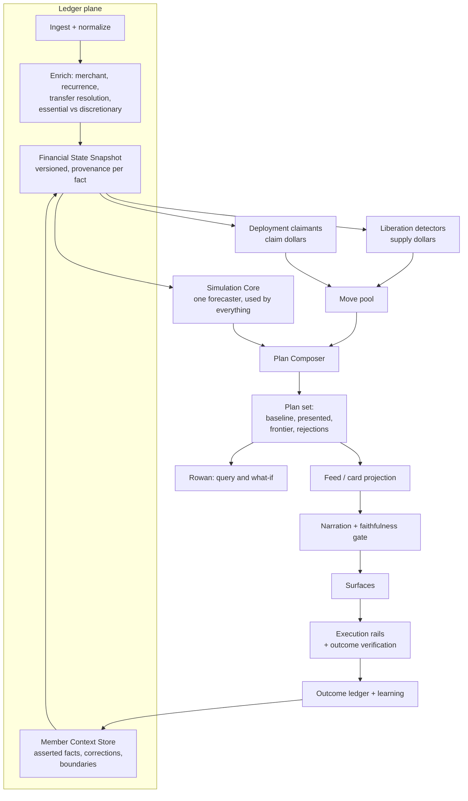
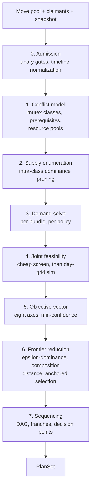

# Architecture

**A proposal: one combinatorial planner over a single universal unit — the Move — fed by two plugin families, and a ledger plane whose job is to make every number reproducible.**

> Companion to [`README.md`](README.md) (product brief) and [`STRATEGY.md`](STRATEGY.md) (full strategy). This document is component-level architecture only: boundaries, contracts, and the handful of decisions that are expensive to reverse. It is not an implementation plan and it is not constrained by anything currently in this repository.

---

## Contents

**The shape of the system** — [The one structural claim](#the-one-structural-claim) · [The Move](#the-move) · [Component map](#component-map)

**The planes** — [Ledger plane](#ledger-plane) · [Simulation core](#simulation-core) · [Opportunity layer](#opportunity-layer) · [Plan Composer](#plan-composer) · [Policy and gates](#policy-and-gates) · [Narration](#narration-and-the-faithfulness-gate) · [Rowan](#rowan-as-a-query-surface) · [Execution rails](#execution-rails) · [Learning loop](#learning-loop)

**Reference** — [The five contracts](#the-five-contracts) · [Failure modes](#failure-modes) · [Open questions](#open-questions) · [What cannot be deferred](#what-cannot-be-deferred)

---

## The one structural claim

The strategy describes two kinds of recommendation: ways to save money, and ways to spend the next incremental dollar well. The instinct is to build two systems. That is the most expensive mistake available here, because the two are the supply and demand sides of the same market for the same dollars.

Whether canceling Apple Music is worth recommending depends entirely on where the freed $10.99/month goes. Into a 24.99% APR balance it is worth roughly $2.75/year more than the cancellation alone. Into checking it is worth nothing, and the card was a lie — we told a member they would save $132 and they saved zero. Split the systems and two failures are guaranteed: a savings plan nobody deploys, and an allocation plan with no budget. You also get double-counted dollars the moment both sides independently claim the same $412 of discretionary income.

**So: one combinatorial planner, two plugin families feeding it.** Liberation plugins create dollars. Deployment plugins claim them. Both emit the same object, and the planner solves them jointly.

---

## The Move

Everything the system can recommend is a Move. A Move's impact is a **cash-flow delta function over time**, not a scalar. This single decision is what makes combination possible, because only things on a shared timeline can be summed and simulated.

```
Move {
  id, type, version
  subjects      accounts, merchants, obligations, goals it touches
  effect        Δ(t) over a 24-month horizon
  durability    one_time | recurring | conditional
  friction      taps, externalHandoff, daysToComplete, reversibility, sessions
  risk          successProbability, downside, variance
  confidence    0..1, detection confidence
  requires      prerequisite moves or state conditions
  excludes      mutex group membership
  claims        typed resource claims against the dollar pools
  trace         inputs, formula, assumptions, provenance
  compliance    advice class
}
```

"Cancel Apple Music" is `+$10.99/mo starting next cycle`. "Send an extra $300 to Chase" is `-$300/mo for 17 months, then +$200/mo freed, plus $3,800 interest avoided`. Those are now comparable and composable. A scalar `annualSavings` field cannot express the second one at all, and a schema that starts scalar will have to be rewritten along with every detector that populates it.

**Durability is a type, not a footnote.** A $3,200 windfall cannot fund a recurring 401(k) increase. The planner must refuse that match structurally, not because a reviewer remembered to check.

---

## Component map



Policy and gates are cross-cutting and deliberately not drawn as a stage — they are consulted at admission, at composition, and at execution.

---

## Ledger plane

Its job is to produce one artifact: a **Financial State Snapshot** that is immutable, versioned, and carries provenance and confidence on every derived fact.

| Component | Owns |
| --- | --- |
| Ingest and normalize | Raw transactions, balances, account metadata; deduplication; pending-to-posted reconciliation |
| Merchant and entity resolution | Canonical merchant identity, plan tier where observable, category taxonomy |
| Recurrence and obligation modeler | Subscriptions, bills, income cadence, predicted next-charge dates, amount history across cycles |
| Transfer and internal-flow resolver | Netting movements between the member's own accounts so they are never counted as income or spend |
| Classification | Essential vs discretionary, category assignment, confidence per assignment |
| Member Context Store | Member-asserted facts, corrections, boundaries, preferences |
| State projector | Assembles the snapshot, computes freshness and completeness scores |

Three things about this plane are load-bearing.

**The snapshot is immutable and versioned.** This is not fastidiousness. It is the only way "Show me the math" renders a stored trace rather than regenerating an explanation, the only way a new detector version can be replayed against historical states to build the golden eval sets Phase 0 requires, and the only way two surfaces asked the same question a second apart cannot disagree.

**The Member Context Store is a peer of the ledger, not an annotation on it.** Observed, asserted, and inferred facts need explicit precedence and TTLs. "That's my mother's car payment, I cover it for her" must durably outrank the inference engine, forever, and must be visible and editable by the member. This is the component behind the "What Rowan knows about you" panel, and it is the cheapest correction mechanism in the product.

**Completeness and freshness are computed scores, not booleans.** They drive the archetype rung, the precondition gates, and the decision to stay quiet.

---

## Simulation core

One forecaster, used by the affordability check, the composer, goal projection, and Rowan's what-ifs.

The strategy promises that a what-if answer and a card answer can never contradict each other. That is only true if there is exactly one implementation of forward cash flow. Two will diverge within a quarter, and the divergence will surface as a member catching us contradicting ourselves — the single most expensive category of bug in this product.

It runs on a **two-resolution grid**: daily for 35 days, monthly to 24 months. Daily precision is non-negotiable in the near term because the cash-flow collision card turns on "rent hits two days before payday," and a monthly grid cannot see a mid-month trough. Beyond 35 days daily resolution buys nothing and costs a great deal of compute.

It exposes: forward balance projection per account, obligation coverage checks, amortization and interest accrual, and stress variants (a missed paycheck, income down 20%).

---

## Opportunity layer

Two plugin families and one shared output type.

### Liberation detectors

Pure functions from snapshot to Moves, one per card type, each declaring the facts it requires.

```
Detector {
  id, cardType, version
  requiredFacts  FactSpec[]
  detect(snapshot) -> Move[]
}
```

The `requiredFacts` declaration is doing more work than it looks. When a detector is blocked on a missing fact and the blocked Move's value clears the bar, the system *derives* an enrichment question. The admission test from the strategy — it must gate something, the payoff must clear $100, we must be unable to infer it, it must be cheap to answer — stops being a policy someone has to remember and becomes a computed property of the architecture. Enrichment questions are generated, not authored.

### Deployment claimants

Claimants expose something different, and this is the most important interface in the system. Not a priority, but a **marginal value curve**: what is the next dollar worth to me, given how many you have already given me?

```
Claimant {
  id, bucket
  marginalValue(state, atDollar, timing, durability) -> ValueVector
  capacity(state) -> { min, max, cliffs }
  toMove(state, amount) -> Move
}
```

The first $500 into an emergency fund is worth vastly more than the $5,000th. Debt paydown is worth the APR, with a discontinuity at payoff when the minimum payment is released. An employer match is worth 100% up to the ceiling and roughly nothing after. Goals have a hard cliff at their deadline.

With curves instead of priorities, "where should my next dollar go" becomes a water-filling problem — allocate each marginal dollar to the highest curve until curves cross. That is both the correct answer and a trivially explainable one: *"your next $500 is worth 24.99% at the card and 4% at the house fund; once the buffer clears $500 the ranking flips"* is a sentence Rowan can say because the engine actually computed it that way.

---

## Plan Composer

The combinatorial core. Seven stages.



### Stage 0 — Admission

Unary gates first, because they shrink the space for free: freshness, stability, compliance class, member boundaries and mutes, non-duplication against in-flight actions.

**Affordability is deliberately not a unary gate**, despite being listed among the precondition gates in the strategy. Affordability is a property of a bundle. Three individually affordable moves can jointly breach the buffer floor, and a move unaffordable alone becomes affordable once a liberation move funds it. Checking it per-card is simultaneously too strict and too loose. It lives in Stage 4 and nowhere else.

### Stage 1 — Three separate conflict mechanisms

The instinct is one conflict graph. It should be three mechanisms, because they behave differently and merging them produces a system nobody can reason about.

| Mechanism | What it models | Where it is enforced |
| --- | --- | --- |
| **Mutex classes** | Same subject, incompatible outcomes — cancel vs. negotiate vs. downgrade the same gym | Enumeration (Stage 2) |
| **Prerequisites** | Hard ordering — open the HYSA before moving $12,000; classify the transfer before counting it as discretionary | Sequencer (Stage 7), validity check at Stage 2 |
| **Resource contention** | Two claimants wanting the same $412 — a shared continuous capacity, not a binary exclusion | Allocator (Stage 3) |

Mutex classes are the structural reduction that makes everything tractable. The space is not 2ⁿ over moves; it is the product of (class size + 1) over classes, including a "do nothing" option per class. A realistic member has perhaps eight liberation subjects with one to three options each — roughly 3⁸ ≈ 6,500 supply bundles, which is nothing.

A fourth interaction is explicitly *not* modeled as a conflict: **value coupling**. Paying off the Chase card releases its minimum payment and shifts every downstream curve. That is real, but it is not an exclusion — it is the reason scores cannot be summed, and it is handled by simulating bundles rather than adding precomputed numbers.

### Stage 2 — Enumerate supply, prune within classes

Dominance pruning is safe within a mutex class and unsafe across classes.

The trap: **prune on the full objective vector, never on dollars alone.** The option dominated on dollars is very often the easy one — the in-app cancel that beats the bill negotiation the member will never complete. Pruning on financial value systematically deletes the plans people actually finish.

Above an enumeration budget of roughly 10⁴, fall back to beam search over classes ordered by value spread, with diversity seeding so the beam does not collapse into one neighborhood.

### Stage 3 — The demand solve, and the cliff problem

For each supply bundle the budget is known: a timeline of incremental dollars typed by durability. Solve the demand side against it, once per **allocation policy**. Policies are doctrines, not weight vectors, and naming them is what makes the output legible:

| Policy | Doctrine |
| --- | --- |
| **Floor-first** | Reach a minimum liquidity floor before any rate arbitrage |
| **Rate-optimal** | Pure risk-adjusted return; the highest marginal curve always wins |
| **Goal-first** | Treat the member's stated goals and dates as near-hard constraints |
| **Split** | Deliberately divide the marginal dollar across two claimants — what members usually want and what a pure optimizer never produces |

Within a policy, the allocator water-fills, jumping to the next curve **crossing point** or **cliff edge** rather than stepping in fixed increments. That is exact, fast, and generates the explanation for free.

**Here is the part that breaks the obvious implementation.** Greedy water-filling is optimal only on concave curves, and the most valuable claimants in this product are not concave. An employer match is a step function. Debt payoff has a discontinuity at zero balance. HSA investment has a threshold. A greedy allocator facing a match cliff will hand dollars to a 24.99% APR card and never accumulate enough to cross the 6% threshold — and it will be confidently, catastrophically wrong on the single highest-value card in the inventory.

The fix is a lookahead that treats cliff crossings as explicit candidate breakpoints: enumerate the allocations landing exactly on each cliff edge, solve greedily between breakpoints, compare. A small dynamic-programming pass, not a research problem — but it must be in the design from the start, because the failure is silent and the wrong answer looks reasonable.

### Stage 4 — Joint feasibility

Run the combined Δ(t) through the simulation core. Hard constraints, violation rejects the bundle outright:

- Minimum balance above the buffer floor on every one of the 35 daily steps and every monthly step after
- Every known obligation covered on its date
- No recurring commitment exceeding a fraction of modeled surplus, so the recommendation sits meaningfully below the computed maximum and leaves margin for our own error

Then a **stress test that scores rather than gates**: re-run with one missed paycheck and with income down 20%. A plan surviving both is qualitatively better than one surviving neither, and that difference should reach the member as a property of the plan rather than staying invisible. It is also the honest answer to "what if my income drops."

Simulation is the compute bottleneck, so this stage is two-tier: an analytic linear screen on aggregate surplus rejects the obviously infeasible; full day-grid simulation runs only on survivors and frontier candidates.

### Stage 5 — Eight axes, and one invariant

| Axis | Definition |
| --- | --- |
| Net value | Discounted Δ(t) over 24 months plus terminal balance-sheet delta, including interest avoided and yield gained |
| Effort | Taps, plus external handoffs at a heavy penalty, plus calendar days, plus distinct sessions required |
| Time to first dollar | When the member actually feels it — cancellation is days, negotiation is weeks |
| Certainty | Detection confidence multiplied by execution success probability |
| Lifestyle cost | What the member gives up; explicitly a weak proxy |
| Resilience delta | Months of essential expenses covered, before and after |
| Reversibility | Cost to undo |
| Robustness | Survival under the Stage 4 stress tests |

Two definitional notes. The **effort penalty on external handoffs** is the calibration that matters most: the employer-match card requires the member to go log into a payroll provider, and if that is weighted like an in-app tap the composer will over-recommend it forever. Start it around fifteen taps and let observed completion rates correct it.

**Lifestyle cost has no good data and must not be dropped.** Dropping it means the optimizer treats canceling a beloved subscription as free. Proxy it from category sensitivity, prior dismissals, and stated boundaries, and label it internally as low-confidence so nothing precise gets built on top of it.

The invariant: **a bundle's confidence is the minimum across its moves, never the average.** Averaging lets a 0.95 move launder a 0.50 move into a shippable plan. A plan is exactly as credible as its weakest claim.

### Stage 6 — From a frontier to three options

With eight objectives nearly every bundle is non-dominated. Pareto filtering alone returns hundreds of plans, which is worse than useless. Three reductions, in order:

1. **ε-dominance on perceptible units.** Quantize each axis to the resolution at which a human notices a difference — a few dollars a month, a couple of taps, a week of elapsed time — then compute dominance on the quantized vector. Principled rather than arbitrary: two plans the member cannot tell apart are one plan. This collapses the frontier by an order of magnitude or more.
2. **Composition distance.** Jaccard distance on move sets. Plans sharing most of their moves are variations, not alternatives. This is where *independence* gets enforced as a constraint rather than a hope.
3. **Anchored selection.** Always include the effort-minimal viable plan and the value-maximal feasible plan as endpoints, then fill the middle with the point of maximum joint spread. Anchoring guarantees the member sees the honest range rather than three points clustered wherever the search happened to converge.

Every selected plan must pass a **characterizability test**: if it cannot be described in one honest phrase — "the painless one," "the fastest," "the maximum" — it does not ship, because a plan the member cannot summarize is a plan they cannot choose.

**The do-nothing baseline is scored and always present**, and every plan is presented as a delta against it. If nothing beats doing nothing by a perceptible margin, the composer returns empty. That is the empty-state-as-a-feature, produced mechanically rather than by someone remembering to hold the line.

### Stage 7 — Sequencing and staging

Topological sort over prerequisites with earliest-start dates, then split into **tranches**: this week, next month, after that. Tranching is what lets the composer emit a five-move plan into a three-card feed without becoming the guilt list the strategy rejects.

Mark **decision points** where the plan branches on something we will learn — "if negotiation fails at day 30, we cancel." Probabilistic moves need this or the plan silently becomes wrong the moment reality resolves.

### Output

```
PlanSet {
  snapshotVersion
  baseline      Plan            // do nothing, scored
  presented     Plan[1..3]
  frontier      Plan[]          // retained, powers "show me other ways"
  rejections    [{ subject, reason, evidence, losingMargin }]
  invalidators  Condition[]     // what would make this stale
}
```

**`rejections` must be structured and persisted, not prose.** The strategy promises Rowan can explain what the ranker considered and discarded; that record has to exist at composition time or Rowan is improvising a rationale, which is precisely the hallucination the design exists to prevent.

**`invalidators` are how plans expire.** Conditions on the snapshot that, if they change, trigger recomposition — a new recurring charge, a balance crossing a threshold, an income event, a completed action. This is what makes the system event-driven instead of a weekly cron across the whole member base.

---

## Policy and gates

A declarative, cross-cutting engine consulted at three points: move admission, plan composition, and execution confirmation. It owns:

- **Precondition gates** — freshness, completeness, stability, non-duplication
- **Compliance class** — which advice categories are permitted, per the Phase 0 legal determination; this is a data-driven allowlist, not code scattered through detectors, so a legal answer changes a config rather than a release
- **Member boundaries** — muted card types and categories, suppression windows after dismissal
- **Rate limits** — three live cards, one per bucket, one open enrichment question, push rationing

Keeping these declarative and centralized is what makes them auditable. A gate implemented inside a detector is a gate nobody can inventory.

---

## Narration and the faithfulness gate

The language model receives a completed trace and writes prose about it. It never originates a number.

The faithfulness check is a **build gate, not a monitor**: every numeric token in generated copy must resolve to a value present in the trace, within formatting tolerance. Failure blocks the card from surfacing. Implemented as a deterministic extraction-and-match pass over the rendered string, it is cheap and it is absolute.

"Show me the math" renders the stored trace. It does not call a model. This is the difference between an audit trail and a second chance to hallucinate.

---

## Rowan as a query surface

Rowan is not a component with its own reasoning about money. It is a read interface over the snapshot and the plan space, plus a constrained re-invocation of the composer.

| Rowan capability | Underlying call |
| --- | --- |
| Explain a card | Render the stored trace |
| "What alternatives did you consider?" | Read `rejections` from the PlanSet |
| "Why not the car loan instead?" | Read the frontier; the alternative is already scored |
| Explore — "where did my money go in August" | Query the snapshot |
| What-if — "max the 401k and delay the house" | Re-run the composer with pinned constraints |
| Teach us | Write to the Member Context Store |

The what-if row is the important one. A what-if is the composer with constraints pinned, running against the same snapshot through the same simulator. That is the structural reason a what-if and a card can never contradict each other — not discipline, but the absence of a second code path.

---

## Execution rails

A Move becomes an Execution Plan: a state machine per action with idempotency keys, an explicit confirmation screen stating exactly what will happen, an undo window wherever the underlying rail allows one, and a terminal outcome.

Rail types: in-app cancellation, concierge cancellation, bill negotiation submission, Smart Savings rule creation, internal transfer, account opening, and **guided handoff** — a deep link plus the exact steps and the exact number to enter, for anything we cannot execute.

**Outcome verification is a distinct component and the one most likely to be skipped.** Did the charge actually stop? Did the transfer land? Realized value is measured against subsequent ledger activity, not assumed at the moment of the tap. Without this the impact ledger is a list of intentions, the north-star metric is unfalsifiable, and we have no way to notice that a card type's advertised savings never materialize.

---

## Learning loop

Four inputs, all of them labels the member volunteered:

| Input | Consumes | Feeds |
| --- | --- | --- |
| Verified outcomes | Ledger activity after an action | Impact ledger, north-star metric, detector calibration |
| Dismissal reasons | "Wrong," "already handled," "not interested," "not now" | Quality tickets, suppression windows, detection-lag measurement |
| Ratings | Post-action thumbs | Ranker weights, eval set |
| Rowan corrections | Free-text durable facts | Member Context Store |

The eval harness replays detector and composer versions against historical snapshots and diffs the resulting PlanSets. Because snapshots are immutable and versioned, this is a pure function — which is what makes golden sets, staged rollout, and per-type rollback mechanically possible rather than aspirational.

---

## The five contracts

Everything above reduces to five interfaces. Get these right and the rest is replaceable.

1. **Snapshot** — immutable, versioned financial state with per-fact provenance and confidence
2. **Move** — subjects, Δ(t), durability, friction, risk, confidence, requires, excludes, claims, trace
3. **Detector** — `requiredFacts` plus `detect(snapshot) -> Move[]`
4. **Claimant** — `marginalValue(...)`, `capacity(...)` with cliffs, `toMove(...)`
5. **PlanSet** — baseline, presented, frontier, rejections, invalidators

---

## Failure modes

**Plan churn is the one to worry about most.** Recomposing against a moving ledger produces a different "best plan" every week, the member restarts continuously, and nothing ever completes. The composer needs **hysteresis**: a new plan must beat the standing plan by a material margin to replace it, and moves the member has already committed to are fixed in subsequent compositions unless they have become actively harmful. Without this, a technically excellent optimizer produces zero completed actions.

**Plans are ephemeral; Moves and commitments are durable.** A member will do two of five things. If the plan is the persisted entity you accumulate stale plan objects and have no clean answer for partial adoption. Persist commitments to individual Moves and let plans be a recomputed view.

**Optimizer stridency.** The value-maximal plan is frequently unlivable. Either cap lifestyle cost on presented plans or let it through labeled honestly as the maximum. Never let it be the default.

**Simulation overfitting.** A plan clearing the buffer floor by $12 is not feasible, it is lucky. Require margin proportional to the variance in the member's spending.

**Frontier collapse.** When the move pool is thin all plans look alike. The correct output is one plan, or none. The pressure will be to synthesize variants to fill three slots — the same failure as filling the feed, one layer deeper where nobody is watching.

---

## Open questions

**1. Pricing risk reduction in dollars.** An emergency fund has no financial return and enormous value. Until someone owns a documented methodology for pricing a month of buffer against 24.99% of avoided interest, the allocator cannot rank the two — and every card in the Stabilize bucket rests on that number. This is the most contentious figure in the system. It needs a named owner and a written defense, because members will argue with it and they will be right to.

**2. Who owns the default objective weights.** The feed needs one top card, so a collapse to scalar must happen somewhere. Anchoring defaults to the archetype rung (Ordered weighted toward effort and speed, Growing toward net value) and personalizing from revealed preference is the proposal, with the frontier behind "show me other ways." But this is a product decision wearing an engineering costume and should be made as one.

**3. Compute shape at scale.** A full recompose is roughly 10³–10⁴ supply bundles, an analytic screen on all of them, full simulation on ~10² survivors, targeting under two seconds. Across 10M members that only works event-driven, keyed off `invalidators`. Most members, most weeks, recompute nothing — which is also the honest reflection of the fact that most weeks nothing changed.

**4. Household.** Shared dollars break the single-claimant model, and duplicate-subscription detection is wrong at the household level in ways it is not at the individual level. Scheduled late, but the Move's `claims` model should reserve room for multi-party pools rather than being retrofitted.

---

## What cannot be deferred

Mapping to the phases in the strategy, most of this is optional in Phase 1. Three things are not, because retrofitting them means rewriting every detector.

| Ships in | Components |
| --- | --- |
| **Phase 1** (six cards, Save + Stabilize) | Ledger plane and snapshot; simulation core; six liberation detectors; two or three claimants; composer stages 0–5 with a degenerate Stage 6 returning a single plan; policy and gates; narration and faithfulness; cancellation, negotiation, Smart Savings and transfer rails; outcome verification |
| **Phase 2** (the loop) | Full frontier and distinctness selection; goal claimants; derived enrichment questions; Member Context Store panel; what-if via pinned-constraint composition; impact ledger |
| **Phase 3** (the ladder) | Wealth claimants with cliff-aware allocation; compliance policy hardening; household resource pools |

The three that cannot wait:

1. **Δ(t) as the Move's impact representation.** Starting with a scalar `annualSavings` means rewriting every detector when the first multi-period card arrives, which is Phase 1 card 7.
2. **Bundle-level affordability.** Per-card affordability checks are wrong from the first day two cards are live simultaneously, and the failure mode is the overdraft the strategy names as the worst case.
3. **Immutable versioned snapshots.** Without them there is no replay, so there are no golden sets, no staged rollout gates, and no way to prove a card type is safe before it reaches ten million people.
