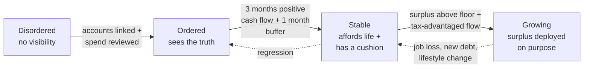
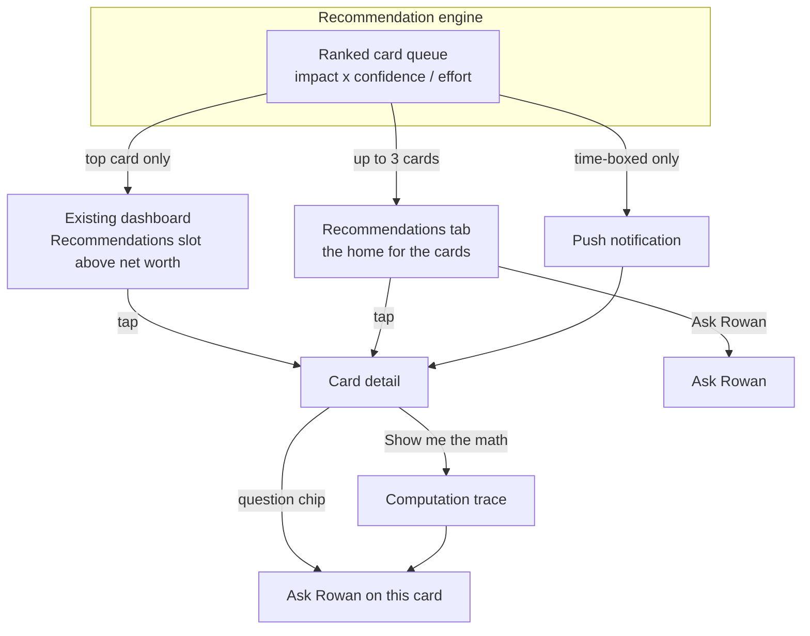
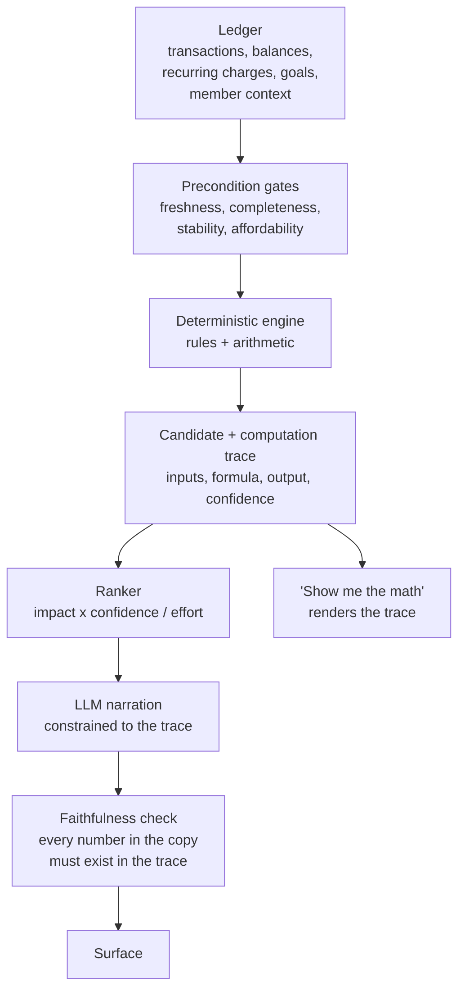
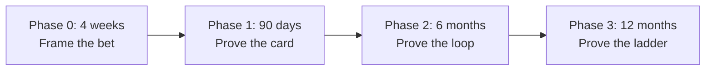

# Recommendations — full strategy

The product-leader brief is in [`README.md`](README.md). This file is the long strategy: market case, 15-card inventory, quality bar, enrichment rules, metrics, risks, and sources.

---

**A proposal: ship Recommendations inside Rocket Money — a ranked feed of action cards, with Rowan as the chat inside it. Not a chatbot. Not another dashboard.**

Its single job is to tell a member the next best thing to do with their money, show them why, and then do it for them where we can.

> This document is a strategy proposal. It intentionally supersedes anything currently in this repository. Nothing here is constrained by existing implementation.

---

## Naming

This is a Rocket Money feature, not a standalone product.

| Name | What members see | Role |
| --- | --- | --- |
| **Recommendations** | Tab label, dashboard slot, card feed | The feature: ranked action cards. |
| **Rowan** | "Ask Rowan" on a card, the chat thread, empty-state first person | The chat inside Recommendations. Explains, models what-ifs, takes context. |

**Recommendations, not "Your tasks."** Tasks are homework. This document already treats a long list of cards as a guilt list, not a product. The feed is advice the member can take or dismiss, not a to-do they failed to finish. The primary action on each card is what turns a recommendation into a completed item — that residue lives in the impact ledger, which *is* a record of work done.

**Rowan is not a second product.** There is no Rowan tab. Rowan is how you talk about a card, and how you explore beyond the cards. Cards stay in Rocket Money's voice ("Cancel Apple Music"). Rowan is the named companion behind "Show me the math" and "what if I delay the house."

---

## Contents

**For leadership** — [The ask](#the-ask) · [Why now](#why-now) · [What this is, and is not](#what-this-is-and-is-not) · [Commercial model](#commercial-model) · [Risks and open questions](#risks-and-open-questions) · [Roadmap](#roadmap)

**For the team** — [The archetype ladder](#the-archetype-ladder) · [Our two target profiles](#our-two-target-profiles) · [The five buckets and the v1 card inventory](#the-five-buckets-and-the-v1-card-inventory) · [UX architecture](#ux-architecture) · [The recommendation quality bar](#the-recommendation-quality-bar) · [The enrichment loop](#the-enrichment-loop) · [Success metrics](#success-metrics) · [Prototype handoff](#prototype-handoff)

**Appendix** — [Sources](#sources)

---


## The ask

Greenlight **Recommendations** as a Premium and Premium+ conversion driver: a ranked feed of action cards, with **Rowan** as the chat behind each one.

**What we want to prove in 90 days:** that a member shown a specific, dollar-quantified, one-tap recommendation acts on it at a rate no dashboard has ever achieved — and that the act is worth more to them than the subscription costs.

**What we need:** a squad on Save-money and Stabilize cards using data Rocket Money already has, a permanent holdout group, and a legal read on how far the wealth-building bucket can go. Nothing in Phase 1 requires new data partnerships.

**The one-line business case:** Rocket Money's existing conversion moment — "we found your forgotten subscriptions" — is a one-time discovery. Once a member has cleaned house, the reason to keep paying gets thinner. Recommendations converts that one-time discovery into a recurring one, and it does so on rails no competitor has.

---


## Why now

Three things are true at the same time, and together they describe a product that could not have been built two years ago and will be table stakes in two more.

### 1. People have already adopted AI for money decisions, but they refuse to act on it blind

The adoption numbers are not speculative. 55% of Americans used AI for a financial task in the past twelve months, and 86% of them say it improved their understanding of their own finances [[1]](#s1). TD Bank measured the same shift inside a single year: the share of consumers who had asked an LLM for financial advice went from 10% to 55% [[2]](#s2). Half of consumers now say managing money without AI will soon feel outdated, and 52% already expect their fintech apps to use it [[1]](#s1).

And then the wall. Only **18%** would trust AI to make a financial recommendation autonomously [[2]](#s2). Only **23%** of people who received AI financial guidance acted on it without first going to get a second opinion — 54% ran their own web search, 31% asked a friend or family member, 29% went and asked a different AI [[3]](#s3). This is not because the advice was bad: 82% rated the quality of that advice as at least "good" [[3]](#s3). They liked the answer and still went looking for proof.

**This gap is not an obstacle to route around. It is the product spec.** Every one of those people is performing manual verification because the tool that gave them the advice couldn't show its work, couldn't see their actual accounts, and couldn't do anything about it. A card that names one action, shows the arithmetic that produced it against the member's real ledger, and executes with one tap is a direct answer to the behavior 77% of AI advice recipients are already exhibiting. 75% of consumers say it matters that they know when AI is involved in a financial decision [[1]](#s1), and 48% say human review of AI guidance would increase their confidence [[2]](#s2) — both are design requirements we can meet cheaply and competitors treat as afterthoughts.

### 2. There is a large, well-documented advice gap, and it is not about willingness

62% of Americans say they at least sometimes avoid important financial decisions out of anxiety or overwhelm. 82% agree that working with a financial advisor would help them. Only 34% have actually sought advice from one in the past year [[4]](#s4).

The blocker is a belief about eligibility. 83% of Americans believe advisors require a minimum level of investable assets, and more than half put that threshold at $50,000 or higher [[4]](#s4). Among investors who manage their own money, the single most common reason for not using an advisor — 41%, well ahead of everything else — is thinking they don't have enough invested to warrant one; another 27% say the cost isn't justified by the value [[5]](#s5). They are not wrong about the cost: advisors typically charge 0.5%–1.5% of assets under management, or $2,500–$9,200 a year on a flat-fee basis, with hourly planning at $150–$400 [[6][7]](#s6).

So the mass market has concluded, reasonably, that personalized financial guidance is a product for other people. Recommendations is that product at $10 a month for the 10 million members already in the app.

### 3. Tracking-first personal finance management is a leaky bucket, and Rocket Money's advantage is that it already acts

Finance apps retain roughly 4%–13% of installs at Day 30, with Day 90 typically under 10% [[8][9][10]](#s8). Only about 14% of finance app users complete activation within 30 days [[8]](#s8). The category's core loop — show the user a chart of what they already did — informs without changing anything, and users correctly conclude they can stop opening it.

Rocket Money is the exception in the category precisely because it doesn't stop at showing. It cancels: over 1,000 supported services, $880M+ returned to members through cancellation alone, and $3.1B+ saved in total across cancellations, bill negotiation, and Smart Savings, for 10M+ members [[11]](#s11). That is the asset. **Rocket Money has action rails. Nobody else in consumer finance AI does.**

An LLM can produce a plausible recommendation today; that is now a commodity. What it cannot do is see the member's ledger, verify its own arithmetic against it, cancel the subscription, move the money, or notice the problem unprompted next month. Recommendations is the intelligence layer on top of rails we already own. Rowan is the AI companion Rocket Money's pricing page already promises members [[12]](#s12). The question is what both of those turn out to be.

### The money is sitting in plain sight

Each recommendation bucket is anchored in a documented, quantified gap. These are the numbers the cards get to act on:


| Bucket                       | The documented gap                                                                                                                                                                                                                                                                                                                                                                                        |
| ---------------------------- | --------------------------------------------------------------------------------------------------------------------------------------------------------------------------------------------------------------------------------------------------------------------------------------------------------------------------------------------------------------------------------------------------------- |
| Save money                   | Consumers estimate $86/month on subscriptions and actually spend $219 — a $133/month blind spot [[14]](#s14). 89% underestimate their total; 66% are off by more than $200/month [[15]](#s15). 59.9% have at least one entirely unused subscription, averaging $26.79/month [[16]](#s16). 70% have been locked into a paid plan by forgetting to cancel a free trial [[16]](#s16).                        |
| Stabilize                    | Only 47% of Americans could cover a $1,000 emergency from liquidity, and 24% have no emergency savings at all [[17]](#s17). 29% carry more credit card debt than emergency savings [[18]](#s18), against an average APR of 22.15% on accounts assessed interest [[19]](#s19).                                                                                                                             |
| Reach your goals             | 31% of Americans say building savings and paying down debt are equally urgent priorities [[18]](#s18) — which is precisely the sequencing question they cannot answer alone and Recommendations can.                                                                                                                                                                                                    |
| Build your wealth            | Roughly one in six eligible workers contributes nothing to their 401(k), ~40% of participants contribute under 5% of income, and 39.7% simply accept a default rate that averages 4.0% — below the 6.5% typically needed to capture a full match worth ~$2,954/year for a median earner [[20]](#s20). Only 22% of HSA holders invest their balance; the rest hold an average $6,477 in cash [[21]](#s21). |
| Improve your recommendations | 69% of consumers are open to sharing personal information when the utility is clear [[1]](#s1) — permission is available, but only in exchange for something visible.                                                                                                                                                                                                                                     |


---


## What this is, and is not

Recommendations is a **ranked feed of action cards**. Rowan is the **chat inside it**. Together they are a recommendation engine with a conversational surface — not a conversational assistant with data access. The distinction determines everything downstream: who initiates, what quality bar applies, and whether the member has to already know what to ask.


| Recommendations is                                                    | Recommendations is not                                               |
| --------------------------------------------------------------------- | -------------------------------------------------------------------- |
| Proactive — it decides what deserves the member's attention this week | A blank prompt waiting for a question the member doesn't know to ask |
| Specific — one action, one number, one deadline                       | A summary of the member's financial situation                        |
| Auditable — every dollar traces to named transactions and accounts    | Confidently fluent about numbers it inferred                         |
| Executing — one tap on rails we own, guided handoff where we don't    | A list of suggestions the member has to go implement alone           |
| Willing to be quiet — "nothing needs your attention" is a valid week  | Obligated to fill a feed                                             |


**The hard rule, and the one to hold the line on: no card ships that only informs.** "Your spending on dining was up 14% last month" is not a card. "Your dining spend has run $180/month over budget for three months; here is the budget change that matches reality, or here is the one habit that closes the gap" is a card. If a proposed card has no action, it belongs in the dashboard Rocket Money already has, or nowhere.

Two structural commitments follow from the trust data, and both are worth stating publicly:

1. **The member decides.** Recommendations never moves money or cancels anything without an explicit confirm on a screen that says exactly what will happen. Given that only 18% of consumers trust autonomous AI financial recommendations [[2]](#s2), and 55% say they would rather get a recommendation more slowly than get it exclusively from an AI agent [[2]](#s2), auto-pilot is the wrong product for this decade regardless of how well it works.
2. **The math is not generated.** Numbers come from a deterministic engine running against the ledger. The language model narrates and prioritizes; it never originates a figure. This is what makes "Show me the math" an audit trail instead of a second hallucination.

---


## The archetype ladder

The mission is to move members up a ladder without requiring them to become financial nerds. That only works if each rung is an **observable state we can compute**, not a persona we assign by vibes. Each rung has an entry test, a bucket that dominates while a member sits there, and a promotion trigger.




| Rung           | Entry test (computed)                                                                                                                                                     | Dominant bucket                                                             | Promotion trigger                                                                                                                           |
| -------------- | ------------------------------------------------------------------------------------------------------------------------------------------------------------------------- | --------------------------------------------------------------------------- | ------------------------------------------------------------------------------------------------------------------------------------------- |
| **Disordered** | Fewer than two accounts linked, or >30% of the last 90 days of spend unreviewed, or no recurring charges confirmed                                                        | Improve your recommendations — we cannot responsibly recommend anything yet | All primary accounts linked, <10% unreviewed spend, recurring charges confirmed                                                             |
| **Ordered**    | Checking, cards, and at least one savings account linked; categorization confidence above threshold; a discretionary-income figure we would defend in front of the member | Save money — the fastest visible wins, and they fund everything above       | Net cash flow positive for 3 consecutive months **and** liquid savings ≥ 1 month of essential expenses                                      |
| **Stable**     | ≥3 months of essential expenses liquid, positive 3-month rolling cash flow, no revolving card balance carried in 2 of the last 3 months                                   | Stabilize, then Reach your goals                                            | 3-month rolling discretionary surplus above a floor (~10% of take-home) **and** at least one tax-advantaged account receiving contributions |
| **Growing**    | Full employer match captured, tax-advantaged contributions on track, surplus deployed rather than idling in checking                                                      | Build your wealth and Reach your goals                                      | No graduation. The loop becomes monitoring and optimization.                                                                                |


Two notes that matter more than they look:

**The Stable bar is genuinely hard.** Only 46% of Americans have three months of expenses saved, and 24% have none at all [[17]](#s17). Most of the app's members are Ordered at best. Recommendations should be honest that moving one rung is a year of work, and should celebrate the rung change explicitly — it is the only moment in personal finance that feels like leveling up.

**The ladder runs downhill too.** A job loss or a new car loan can demote a member from Growing to Stable in a month. Recommendations must handle demotion without shaming: the same detection that promotes should quietly re-rank the feed toward Stabilize cards, and Rowan should be able to say "your situation changed, so I changed what I'm watching." Products that only ever congratulate you become unusable at exactly the moment you need them.

---


## Our two target profiles

We are deliberately not building for the power user. The target is the member who wants a competent answer and does not want a hobby. Two profiles bracket that range, and they sit on adjacent rungs — which is convenient, because it means one product serves both with different card mixes rather than different apps.

### Independent Saver — Ordered, on the edge of Stable

Earns well and saves responsibly, but has limited financial knowledge and no framework for sequencing. Wants Recommendations to find what they're missing, explain it plainly, and name the next step — especially while trying to balance investing against a house or a car.

Their defining failure mode is not overspending, it is **idle competence**: money accumulating in a checking account earning nothing, an employer match half-captured, a down payment goal with no math behind its date. They don't need discipline. They need a priority order.

What Recommendations owes them:

- **Sequencing over information.** The signature card is "here is where your next dollar should go, and here is what it beats." Never a list of five things to consider.
- **Plain-language teaching as a side effect, never as the payload.** They learn what an employer match is because a card told them they were leaving $1,896 of it on the table, not because we shipped a lesson.
- **Explicit tradeoff framing.** "Funding the house on time means the car moves to 2029" is the sentence they cannot construct themselves and desperately want.
- **A low question budget.** They will answer two questions to unlock a real recommendation. They will abandon an onboarding questionnaire.


### Strategic Planner — Growing

Already understands investing and wealth building, and is spending too many hours a month on tradeoffs they're capable of evaluating. Wants Rowan to behave like a financially sophisticated friend: watch the accounts, surface opportunities and risks unprompted, model "what if," and leave the decision alone.

Their defining failure mode is **analysis cost**. They will notice most of what Recommendations notices — eventually, on a Sunday, in a spreadsheet. The value is not insight, it is vigilance and speed.

What Recommendations owes them:

- **Monitoring, not tutoring.** Cards that lead with the number and the delta. No explanation unless they open it. Progressive disclosure earns its keep here: the same card that teaches the Independent Saver must be skimmable in three seconds for this member.
- **What-if modeling as a first-class surface.** "What if I max the 401k and delay the house by a year" is the question they came for, and it lives in Rowan, not on a card.
- **Being told when nothing is wrong.** A weekly "I checked, here's what changed, nothing needs you" is worth real money to someone whose alternative is checking manually.
- **No condescension and no false precision.** This member will find the flaw in our math, and will churn permanently the first time we round something in our favor.

Both profiles converge on the same demand: **be right, show me why, and don't waste my attention.** That is the whole brief.

---


## The five buckets and the v1 card inventory

Fifteen card types, three per bucket. Every entry below is a real candidate for v1 or v2, written the way it would appear to a member. Dollar figures in the example copy are illustrative of a plausible member, but every one of them is arithmetic a deterministic engine can produce and defend.

Each card carries the same anatomy: **a headline that states the action and the number**, one line of why, a primary action, and 2–4 tailored questions. The questions are not decoration — they are the progressive disclosure mechanism, and they are how we learn which part of a recommendation members don't believe.

### Bucket 1 — Save money

Fastest visible wins. This bucket funds everything above it on the ladder, and it is where Rocket Money's existing rails make us unbeatable.

**1. Duplicate or overlapping subscription** — `Phase 1`

> **Spotify and Apple Music both billed this month**
> $19.99 and $10.99. One might be extra — about $132 a year — or both might belong: a phone bundle, two people, different devices. We can't tell from the charges. Medium confidence.

- **Action:** not a cancel. Primary is "I'll tell you what's going on" (Rowan). Counter is "Leave it."
- **Data:** recurring charge detection, merchant category taxonomy, charge history ≥2 cycles
- **Questions:** "Could this be a bundle?" · "Who uses which?" · "Show me the math" · "I want to drop one"
- **Known failure mode:** overlap is not waste. Bundles, family sharing, and platform lock-in are common. This card flags a possible $132 and waits for the member. Confidence stays medium until they say what's going on.

**2. Free trial converting to paid** — `Phase 1`

> **Peacock is free until Sept 24. Still using it?**
> If you are, it becomes $13.99 a month on the 24th. If you're not, we can cancel by the 23rd so you don't get charged — you keep it through the 24th either way.

- **Action:** Keep using it (primary) · Cancel so I'm not charged (secondary)
- **Data:** trial-start detection ($0 or $1 authorization followed by a scheduled first charge), predicted first-charge date, merchant plan pricing
- **Questions:** "How do you know it's a trial?" · "What happens if I cancel?" · "Show me the math"
- **Honesty constraint:** we cannot observe whether the member has used a third-party service, so this card must never imply usage ("you've only watched once"). It gets to say what it can see: a date and a price. The first question is keep vs drop, not cancel-by-default. 70% of people have been locked into a paid plan by forgetting to cancel a trial, and it has cost the average person who did $34.31 [[16]](#s16) — the deadline is still the value.

**3. Recurring charge price increase** — `Phase 1`

> **Your gym raised its price $15/month in July — $180/year**
> Planet Fitness went from $39.99 to $54.99. You have two options and we can run either one.

- **Action:** Submit to bill negotiation · or cancel
- **Data:** recurring amount history across ≥3 cycles, merchant negotiation eligibility
- **Questions:** "Show me the charge history" · "What are the odds negotiation works?" · "What do comparable gyms near me cost?" · "Cancel it instead"
- **Why this card matters strategically:** 67% of adults saw at least one subscription price rise in the past year [[22]](#s22), and almost none of them noticed the month it happened. This is a detection advantage that requires no new data.


### Bucket 2 — Improve your recommendations

The enrichment bucket. It exists because recommendation quality is bounded by data quality, and it is governed by the strictest rule in the product: **Recommendations must earn the right to ask.** Full mechanics in [The enrichment loop](#the-enrichment-loop).

**4. Unlock a blocked recommendation** — `Phase 2`

> **One question unlocks your next recommendation**
> Is your $1,450 monthly transfer to Ally rent, or savings? Your answer moves your discretionary income by $1,450 — and it decides whether we tell you to attack your credit card or build your emergency fund first.

- **Action:** two-tap answer
- **Data produced:** transfer classification, which reclassifies 12 months of history at once
- **Questions:** "Why does this change things?" · "What will you recommend either way?"
- **Design requirement:** the card must name what the answer unlocks, in dollars or in a specific recommendation. A question with an unstated payoff is a survey, and we don't ship surveys.

**5. Rate a recommendation** — `Phase 2`

> **You canceled Apple Music three weeks ago. Still the right call?**
> 👍 / 👎 — and tell us in a line if we got it wrong.

- **Action:** the rating itself, which re-weights card ranking for this member and feeds the eval set for everyone
- **Why this is an action card and not an informational one:** the member is doing something with a consequence. It is also the only honest way to measure whether our recommendations were good, as opposed to merely accepted. A card can be tapped and still be wrong.

**6. Set a boundary** — `Phase 2`

> **You've passed on three cancellation suggestions**
> Want us to stop suggesting cancellations in Entertainment, or keep them coming?

- **Action:** mute a card type or category, permanently or for 90 days
- **Why it exists:** giving members a volume knob is cheaper than losing them. 62% of people call too-frequent notifications spam and 55% cite irrelevance [[23]](#s23); one weekly push is enough to make 10% disable notifications and 6% uninstall [[23]](#s23). An explicit off switch is a retention feature.


### Bucket 3 — Stabilize your financial situation

The highest-stakes bucket. These cards move real money, and a mistake here can cause an overdraft. Every card in this bucket runs an affordability check against the next 35 days of known obligations before it is allowed to surface.

**7. Redirect discretionary income to high-interest debt** — `Phase 1`

> **Send an extra $300/month to your Chase Freedom and save about $3,800 in interest**
> You have $412/month of discretionary income that isn't doing anything. Your $6,800 balance is at 24.99% APR — the most expensive dollar in your finances. At your current $200/month you'd be paying this off for five more years. At $500 you're done in 17 months.

- **Action:** schedule a recurring payment (guided handoff to the card issuer where we can't execute)
- **Data:** liability balances, APR (a gap today — see [data dependencies](#risks-and-open-questions); v1 asks once via card 4), 90-day discretionary income and payment history, upcoming obligations
- **Questions:** "Show me the math" · "What if I only add $150?" · "Shouldn't I build savings first?" · "Would a balance transfer beat this?"
- **The sequencing question is the real value.** 31% of Americans say emergency savings and debt paydown are equally urgent [[18]](#s18) — a tie they can't break. Recommendations breaks it with their actual numbers, and the honest answer depends on the spread between their APR and their buffer, which is exactly the kind of arithmetic nobody does at their kitchen table.

**8. Build the emergency buffer** — `Phase 1`

> **Automate $150/week and you'll pass a $500 cushion in three weeks**
> You have $180 in savings against $3,240/month of essential expenses. We start at $500 because it covers most surprises — at this pace you'd reach a full month of expenses in about five months.

- **Action:** create a Smart Savings rule
- **Data:** essential vs discretionary spend split, savings balances, income cadence
- **Questions:** "Why $500 first?" · "Can I actually afford this?" · "What counts as an emergency?" · "What if my income drops?"
- **Grounding:** only 47% of Americans could cover a $1,000 emergency from liquidity and 24% have nothing set aside [[17]](#s17). The staged target ($500, then one month, then three) matters — a card that opens with "you need $9,720" gets dismissed, and 54% of people already say inflation is why they're saving less [[17]](#s17). Meet them at $500.

**9. Cash-flow collision ahead** — `Phase 1`

> **Your rent hits two days before payday and leaves you $86 short**
> Oct 3 rent is $1,800 and your balance will be $1,714. Move $200 from savings on Oct 1, or shift your auto-transfer to the 6th.

- **Action:** one-time transfer · or reschedule the conflicting auto-transfer
- **Data:** recurring obligation calendar, income cadence prediction, current balances
- **Questions:** "Show me the timeline" · "Which option is better?" · "Does this happen every month?"
- **This is the card that earns permission for everything else.** Preventing one $35 overdraft is more viscerally valuable than any optimization we will ever suggest, and it is the clearest possible demonstration that Recommendations is watching. It is also the only card type that justifies a push notification by default.


### Bucket 4 — Reach your goals

A goal is a specific amount, by a specific date, for a specific reason. That structure makes goals the most computable thing in the product — and the place where Recommendations can be most useful by delivering unwelcome news early.

**10. Goal is off pace — two levers** — `Phase 2`

> **Your house down payment needs $429 more a month, or a later date**
> $40,000 by June 2029 means $1,109/month from here. You've averaged $680 for five months and have $3,400 saved. You have $412/month of discretionary income, so closing the whole gap isn't quite possible — and at your current pace you'd get there in March 2031.

- **Action:** raise the contribution · or move the target date (both write back to Financial Goals)
- **Data:** goal parameters, contribution history, discretionary income, expected return on the holding account
- **Questions:** "Show me both scenarios" · "Where would the extra $429 come from?" · "Is a HYSA or a brokerage right for a 2029 goal?" · "What if I split the difference?"
- **Design principle:** always present the tradeoff as concrete levers with numbers attached, never as a warning. A member told "you're behind" feels bad; a member told "$429 a month or 21 more months, pick one" makes a decision. Note that this particular example is deliberately uncomfortable — neither lever alone quite closes the gap, which is exactly the sequencing conversation the member needs and will never start on their own. Softening it into "you're a bit behind on your goal" would make the card worthless.

**11. Goals in conflict** — `Phase 2`

> **Your house fund and car fund are competing for the same $412**
> Funding both on their current dates isn't possible. Here's what sequencing looks like either way.

- **Action:** choose a priority order, which re-plans both goals
- **Questions:** "Show me both orders" · "What if I lower the car target?" · "Which one should come first and why?"
- **Why it's necessary:** goal features across the category let members create goals that are collectively impossible and then quietly fail all of them. Naming the conflict at month two instead of month twenty is the entire job.

**12. Windfall allocation** — `Phase 2`

> **$3,200 landed on Sept 12 — here's the best place to put it**
> It doesn't match your usual paycheck. Sending it to your 24.99% card avoids about $900 in interest, which beats every other option you have right now.

- **Action:** allocate to the recommended destination, or pick from a ranked list
- **Data:** anomalous deposit detection, income pattern baseline, all liability APRs and goal shortfalls for ranking
- **Questions:** "Why the card and not my house fund?" · "Show me the ranking" · "Can I split it?" · "What if this is earmarked already?"
- **Timing is the feature.** A windfall is allocated within about a week or it dissolves into ordinary spending. This card has a short, real deadline and should surface within 48 hours of detection.


### Bucket 5 — Build your wealth

The highest-value bucket and the most constrained. Two things gate it: **data we don't have yet** and **a compliance line we have not drawn**. Both are addressed in [Risks and open questions](#risks-and-open-questions), and this bucket is deliberately scheduled last.

**13. Employer match shortfall** — `Phase 3`

> **You're leaving $1,896 a year of your employer's money on the table**
> You contribute 4%. Your plan matches dollar-for-dollar up to 6%. Raising your contribution by 2% means $158/month more of your pay going in — less than that out of your take-home, since it's pre-tax — and captures $1,896/year you currently don't get.

- **Action:** guided handoff — a deep link to the payroll or plan provider with the exact steps and the exact number to enter. We cannot execute this, and pretending otherwise would be the worst kind of failure.
- **Data:** 401(k) contribution rate and plan match formula — neither of which Rocket Money has today. v1 of this card is unlockable only by asking the member (two questions), which makes it the single best justification for the enrichment loop existing.
- **Questions:** "Show me the math" · "Can I afford a 2% cut in take-home?" · "Roth or traditional?" · "What if I only raise it 1%?"
- **Grounding:** the classic Financial Engines study found 25% of participants miss part of their match, at a typical cost of $1,336/year and $24B nationally [[24]](#s24) — dated, but the structural conditions haven't changed. More recent data: average promised match is 4.7% of pay, roughly one in six eligible workers contributes nothing, ~40% of participants contribute under 5%, and 39.7% accept a default rate averaging 4.0% while the full match typically needs ~6.5% — about $2,954/year for a median earner [[20]](#s20).
- **Compliance note:** this card recommends a contribution rate against a documented plan formula. It does not recommend a security. That distinction is likely the difference between shippable and not.

**14. HSA sitting in cash** — `Phase 3`

> **$6,400 has sat in your HSA cash account for two years**
> You've averaged $340/year in medical spending, so most of this balance isn't working. Your plan offers investment options for balances above $1,000.

- **Action:** guided handoff to the HSA administrator's investment election
- **Data:** HSA balance and cash/invested split, medical spend history, administrator investment threshold
- **Questions:** "Why is this different from my 401k?" · "How much should I keep in cash?" · "What's the tax advantage here?"
- **Grounding:** only 22% of HSA participants invest, average balances sit at $6,477, and just one quarter of employers even frame HSAs as long-term savings [[21]](#s21). This is one of the largest unexploited advantages in consumer finance and almost nobody is told about it.
- **Compliance note:** "your balance is idle and your plan offers investment options" is materially different from "buy this fund." The card stops at the former.

**15. Savings earning a checking rate** — `Phase 2`

> **Your $12,000 could earn about $374 more a year**
> Ally pays 0.38% — about $46 a year. A high-yield savings account is the same idea as Ally, just a better rate: banks are offering about 3.5% right now, which is $420 a year. It's still a savings account — your money, same-day access, FDIC-insured. Not an investment. Rocket Money can open one in about 5 minutes.

- **Action:** open a high-yield savings account via Rocket Money (~5 minutes), then move the $12,000. Do not assume the member already has one.
- **Data:** savings vs checking split, current APY on the savings account, high-yield rate, upcoming large obligations
- **Questions:** "What is high-yield savings?" · "Is this safe?" · "Show me the math" · "Is this my emergency fund?"
- **This is the Independent Saver's signature card.** The member already did the hard part — they saved. The miss is the rate, and the first realistic step is opening the account. $12,000 covers ~3.7 months of essentials, so this is a rate card, not a "build a buffer" card. Opening a deposit account is not securities advice. Disclose the partner bank and FDIC protection the same way we'd want it disclosed to us.


### What is deliberately absent

No card recommends buying, selling, or holding a specific security. No card tells a member to open an account with a partner we're paid by, at least not without the same disclosure standard we'd want applied to us. No card informs without asking for something. And no card is generated from an LLM's unverified impression of a member's finances.

---


## UX architecture

The design constraint is a member who is not a power user and has about eight seconds. Everything below follows from that: minimal surface, ranked hard, progressively disclosed, and quiet when there's nothing worth saying.

### Two surfaces, one feed

Recommendations appears in exactly two places, and they share a single ranked queue.




**The dashboard slot** carries one card and one card only, positioned above net worth and spending. It is the highest-traffic real estate in the app and the reason Recommendations gets discovered at all. A member who never opens the Recommendations tab still sees the single most valuable thing we noticed this week. If there is nothing above the quality threshold, the slot collapses rather than degrading to a filler card.

**The Recommendations tab** is the home for the feed, capped at three live cards (see below), plus Ask Rowan and the member's context panel. It is a fifth tab, not a replacement for the dashboard — Rocket Money's existing home does a job Recommendations shouldn't try to absorb, and asking members to relearn the app is an unnecessary risk to bundle with a new feature.

**Push is rationed to time-boxed cards only** — free trial deadlines, cash-flow collisions, windfall allocation. Never optimization cards, never enrichment questions, never "you have a new recommendation." One irrelevant push is enough to make 10% of users disable notifications and 6% uninstall [[23]](#s23), and 62% call excess volume spam [[23]](#s23). The 2026 benchmark guidance is consistent: relevance, not volume, determines whether frequency is survivable [[25]](#s25). The ceiling should be roughly one push per week, and it should routinely send zero.

### Feed rules

The ranking function is `expected annual impact × confidence ÷ member effort`, with time-boxed cards preempting everything else as their deadline approaches. On top of that, four hard rules:

1. **Three live cards maximum.** A backlog of fifteen recommendations is a guilt list, not a product. Additional candidates wait in the queue; they don't stack up in the UI.
2. **At most one card per bucket at a time.** Prevents the feed from becoming five variations on "cancel something."
3. **Dismissal requires a reason, and the reason is the payload.** "Already handled," "not interested," "this is wrong," "not now." Each routes differently: *wrong* files a quality ticket, *already handled* suppresses and tells us our detection lagged reality, *not interested* mutes the type for 90 days.
4. **Completed cards leave visible residue.** A card that has been acted on moves to an impact ledger the member can scroll — "canceled Apple Music, saving $131.88/year." This is the accumulating proof that justifies the subscription, and it is the honest scoreboard for us too.


### Card anatomy

```
┌─────────────────────────────────────────────┐
│  SAVE MONEY                        · · ·    │   bucket tag + dismiss
│                                             │
│  Cancel Apple Music and save                │   headline: action + number
│  $131.88 a year                             │
│                                             │
│  You're paying for two music services.      │   one line of why
│  Spotify Family and Apple Music both        │
│  charged in the last 30 days.               │
│                                             │
│  ┌───────────────────────────────────────┐  │
│  │        Cancel Apple Music             │  │   primary action
│  └───────────────────────────────────────┘  │
│         Both are intentional                │   honest counter-action
│                                             │
│  ⌄ Show me the math                         │   layer 2, inline
│                                             │
│  ( Who's using each one? )                  │   2-4 tailored questions
│  ( Would Family cover us both? )            │   → layer 3, Rowan
│                                             │
│  ⓘ AI helped write this. The math           │   AI disclosure
│     comes from your transactions.           │
└─────────────────────────────────────────────┘
```

Three details in there are doing real work. The **counter-action** sits at equal visual weight to the primary action, because a card that only offers agreement is a card that will be tapped when it's wrong. The **AI disclosure** is there because 75% of consumers say it matters that they know when AI is involved in a financial decision [[1]](#s1), and because being the app that says so first is cheap differentiation. And the **question chips are card-specific and pre-computed**, not a generic "ask Rowan" — the member should never have to invent the question.

### Progressive disclosure in three layers


| Layer           | Time budget | Content                                                                                               | Who stops here                                 |
| --------------- | ----------- | ----------------------------------------------------------------------------------------------------- | ---------------------------------------------- |
| **1. The card** | 5 seconds   | Action, dollar amount, deadline, one line of why                                                      | Strategic Planner, most of the time            |
| **2. The math** | 30 seconds  | The computation trace: named transactions, the formula, the result, the assumptions and their sources | Independent Saver, on cards that surprise them |
| **3. Rowan**    | Open-ended  | Anything — alternatives, what-ifs, objections, corrections                                            | Anyone whose situation the card didn't capture |


The layers must be genuinely nested, not three views of the same summary. Layer 2 is the actual audit trail described in [the quality bar](#the-recommendation-quality-bar), rendered rather than regenerated. Layer 3 opens with the card's full computation already in context, so the member's first message can be "why not the car loan instead" without re-establishing anything.

### Rowan

Rowan has two entry points and three jobs.

**Ask Rowan on a card** launches from a question chip or from the card itself, pre-loaded with that card's inputs, trace, and the alternatives the ranker considered but rejected. That last part is what makes "What alternatives did you consider?" answerable with substance instead of improvisation — the ranker already evaluated them, so Rowan is reading a record, not inventing a rationale.

**Ask Rowan** (global) lives in the Recommendations tab. Its three jobs, in order of how much they matter:

1. **Explore** — "can I afford a $600 car payment," "where did my money go in August." Ordinary questions against real data.
2. **Teach us** — the highest-bandwidth enrichment channel in the product. Every "that's actually my mother's car payment, I pay it for her" is a permanent improvement to every future recommendation. Rowan must write back to a persistent member-context store, and the member must be able to see and edit what we recorded. A visible **"What Rowan knows about you"** panel is both a trust device and the cheapest correction mechanism we will ever build.
3. **What-if** — "what if I max my 401k and push the house to 2029." Scenario modeling with the same deterministic engine that produces cards, so a what-if answer and a card answer can never contradict each other. This is the Strategic Planner's primary surface and the strongest Premium+ justification in the product.


### The empty state is a feature

Some weeks Recommendations will have nothing above the bar. The correct response is Rowan saying so:

> **Nothing needs your attention this week.**
> I checked your accounts on Tuesday. Your cash flow is on track, no unusual charges, your house fund is on pace. I'm watching your Peacock trial — it converts on the 24th.

This state has to be designed with as much care as the cards, for three reasons. It is the honest output of a system with a real quality threshold. It is worth actual money to the Strategic Planner, whose alternative is checking manually. And without it, the pressure to fill the feed will quietly destroy the precision bar that makes the whole product credible — the failure mode is not that we run out of cards, it's that we start shipping bad ones to avoid an empty screen.

### Onboarding

No questionnaire. The first Recommendations card is generated from linked-account data alone, and the first question it ever asks is one that unlocks a specific recommendation it has already found. The pitch at the paywall is a real number, not a promise — see [Commercial model](#commercial-model).

---


## The recommendation quality bar

This is the section that decides whether Recommendations is a feature or a liability. A wrong recommendation delivered to 10 million members is not a bug, it's an incident, and the failure mode is asymmetric: one bad card costs more trust than ten good ones earn.

### Deterministic math, generative language

The architecture separates what must be correct from what must be readable.




Two invariants make this whole document credible:

**The language model never originates a number.** It receives a completed trace and writes prose about it. Any figure in card copy that does not appear in the trace is a build failure, caught by an automated faithfulness check before the card can surface — not a monitoring concern, a gate.

**"Show me the math" renders the stored trace, it does not regenerate an explanation.** This is the difference between an audit trail and a second chance to hallucinate. The trace records the actual inputs with timestamps and source accounts, the formula applied, the output, and every assumption with its provenance:

```
Inputs
  Spotify Family        $19.99   Chase •4412   Aug 14, Sep 14      (2 cycles confirmed)
  Apple Music Individual $10.99  Chase •4412   Aug 22, Sep 22      (2 cycles confirmed)
  Category match        music streaming (merchant taxonomy v4)
Formula
  annual_savings = 10.99 x 12 = $131.88
Assumptions
  Both subscriptions are active         (last charge within 35 days)
  Both serve the same need              (category overlap, not usage — we cannot see usage)
  Price stable                          (no increase across observed cycles)
Confidence  0.91  →  action card
```

Note the assumption stated as a limitation: *we cannot see usage*. Making the engine declare what it doesn't know is what keeps copywriting honest downstream.

### Precondition gates

A candidate is suppressed before ranking unless all of these hold. Suppression is silent; the member never sees a card that failed a gate.


| Gate                | Requirement                                                                                                                      | Why                                                                  |
| ------------------- | -------------------------------------------------------------------------------------------------------------------------------- | -------------------------------------------------------------------- |
| **Freshness**       | All accounts material to the computation synced within 72 hours                                                                  | Stale balances produce advice that was right last week               |
| **Completeness**    | ≥90 days of history; all primary accounts linked; <10% of relevant spend unreviewed                                              | The Disordered rung exists because we shouldn't recommend into a fog |
| **Stability**       | Recurring charges observed for ≥2 cycles; income pattern established                                                             | One-off charges masquerade as subscriptions                          |
| **Affordability**   | For any card that moves money: simulate the next 35 days of known obligations and confirm the member stays solvent with a buffer | The worst thing Recommendations can do, see below                              |
| **Non-duplication** | No conflicting card live, no pending action on the same accounts, not dismissed within the suppression window                    | Contradicting ourselves is worse than saying nothing                 |


### Confidence changes the card, not just the wording


| Confidence               | Treatment                                                                                                                                     |
| ------------------------ | --------------------------------------------------------------------------------------------------------------------------------------------- |
| **≥0.90 — Confirmed**    | Full action card with a one-tap primary action                                                                                                |
| **0.60–0.89 — Probable** | Action card with an inline "does this look right?" confirm on the specific uncertain input, before the action commits                         |
| **<0.60 — Unconfirmed**  | Not a recommendation. It degrades into an [enrichment question](#the-enrichment-loop) that resolves the uncertainty, or it stays in the queue |


The degradation path is the important part. The instinct when confidence is low is to hedge the copy — "you *may* have a duplicate subscription." That produces a card that is simultaneously unhelpful and unfalsifiable. Asking one question instead is better on every dimension.

### The worst case, named

**Recommendations tells a member to send $300 to their credit card, and that $300 was rent. The rent bounces. We caused a $35 overdraft fee, a late fee, and possibly a credit event.**

Every card in the Stabilize and Goals buckets exists downstream of this scenario. Concretely, it means: the affordability gate is mandatory and non-overridable; any transfer recommendation must simulate the member's next 35 days rather than looking at a current balance; ambiguous large transfers must be classified before they can be counted as discretionary (which is exactly what [card 4](#card-4) is for); and the recommended amount should sit meaningfully below the computed maximum, because a recommendation at 100% of available surplus is a recommendation with no margin for our own error.

### False positive taxonomy

Every card type ships with its canonical failure documented, a detection strategy, and a graceful counter-action. A sample:


| Card                   | Canonical false positive                                                                      | Mitigation                                                                     |
| ---------------------- | --------------------------------------------------------------------------------------------- | ------------------------------------------------------------------------------ |
| Duplicate subscription | The second account is intentional — a family member, a platform lock-in                       | Equal-weight "both are intentional" counter-action; permanent pair suppression |
| Free trial converting  | It isn't a trial; it's an annual plan renewing, or a merchant with irregular billing          | Require the $0/$1 authorization pattern, not just a first-time charge          |
| Debt reallocation      | The "discretionary" income is committed to something we can't see (cash rent, family support) | Affordability simulation + classify ambiguous transfers first                  |
| Emergency fund         | The member already has a buffer at an institution we can't see                                | Counter-action: "I have savings elsewhere," which adjusts the ladder position  |
| Employer match         | Our understanding of the match formula is wrong or out of date                                | Show the formula we're using and let the member correct it in one tap          |
| Idle cash              | The balance is earmarked — a tax bill, a closing, a planned purchase                          | Ask before recommending on any balance above a threshold                       |


The pattern across all of them: **the mitigation is almost always a counter-action or a question, not better detection.** We will never detect intent from transactions alone, so the product has to be built to be corrected cheaply.

### Evaluation

- **Golden set per card type.** 200+ anonymized real member profiles per type, each labeled by a qualified reviewer with the correct outcome: should this card fire, and is the recommendation appropriate.
- **Three measured dimensions.**
  - *Math accuracy* — target **1.0**. Any arithmetic error is a P0 that blocks release. There is no acceptable rate of getting the number wrong.
  - *Precision* — would a qualified reviewer agree the card should have fired for this member, and that the advice is appropriate to their situation? Ship gate: **≥0.90** for any card with a money-moving action.
  - *Copy faithfulness* — does every claim in the narration trace to the computation? Target **1.0**, enforced automatically.
- **Recall is explicitly a secondary metric.** Missing an opportunity costs us a card. Firing a wrong one costs us the member. We tune for precision and accept that Recommendations will be quiet more often than a competitor.
- **Human review in the loop.** A qualified reviewer samples live cards weekly per type, and reviews 100% of a card type's output during its staged rollout. 48% of consumers say human review of AI guidance would increase their confidence [[2]](#s2), so this is both a quality mechanism and something worth telling members about.
- **Staged rollout, always.** New card types go 1% → 10% → 50% → 100%, gated on action rate, dismissal-as-wrong rate, and zero math errors at each step.


### Reversibility and what happens when we're wrong

- **Every action has an explicit confirm** that states exactly what will happen in plain language, and an undo window wherever the underlying rail allows it. Nothing executes silently. Cancellations take 2–10 days through the existing service [[12]](#s12), which is a natural reversal window we should expose rather than hide.
- **Every card has a one-tap "this is wrong"** that files a real quality ticket against the card type, not a generic feedback form. Members who tell us we're wrong are doing free eval labeling and should be treated accordingly.
- **A make-it-right policy, published.** If a Recommendations card causes an overdraft or late fee, we reimburse it. This is not a legal footnote, it's a product decision with a real budget line: 80% of consumers believe companies should reimburse them for AI-driven mistakes [[1]](#s1). Committing to it in advance is the single cheapest way to buy the trust that 77% of AI advice recipients currently withhold [[3]](#s3).
- **A published accuracy commitment.** We say what our precision bar is and what we do when we miss it. Nobody in the category does this, and it is the most defensible differentiator in the proposal.

---


## The enrichment loop

Recommendation quality is capped by data quality, and some of the highest-value cards in the inventory — the employer match card most of all — are blocked on things only the member can tell us. But a product that asks its way to better recommendations becomes a chore, and the constraint in the brief is explicit: only ask about truly necessary information.

So questions are rationed by rule, not by judgment.

### The admission test

A question may be asked only if **all four** hold:

1. **It gates something.** The answer unblocks at least one specific candidate recommendation that is otherwise suppressed. No questions asked for future usefulness or profile completeness.
2. **The payoff clears a bar.** That recommendation's expected annual impact is ≥$100, *or* the answer unblocks an archetype promotion (which unlocks a whole bucket).
3. **We can't infer it.** We cannot derive the answer from the ledger at ≥0.80 confidence. If we can infer it, we infer it and offer a correction instead of asking.
4. **It's cheap to answer.** Two taps or fewer. A question requiring the member to go look something up must be worth substantially more, and must explain why it's worth the trip.


### The budget

- **One open question at a time.** Never a stack.
- **Roughly one per week, ceiling not target.** Most weeks should have zero.
- **Never in a push notification.** Enrichment questions are pull-only, encountered in the app.
- **Always state the payoff, in dollars or as a named recommendation.** "This unlocks a $1,896/year recommendation about your 401k" is the whole reason the member answers. 69% of consumers are open to sharing personal information when the utility is clear [[1]](#s1) — the operative word is *clear*, and vague requests forfeit the permission.


### Three channels, in order of value

**1. Rowan, as a side effect.** The richest source by a wide margin, and it costs the member nothing because they were already talking. "That's my mom's car payment, I cover it for her" resolves an ambiguity we would otherwise have to ask about, and it arrives with context no form field could capture. Every Rowan session should be mined for durable facts.

**2. Dismissal reasons.** A dismissal is a labeled training example the member volunteered. "Already handled" tells us our detection lagged; "this is wrong" tells us our precision is off for this segment; "both are intentional" is a permanent fact about their household.

**3. Direct questions.** The most expensive channel, reserved for the genuinely blocking unknowns. In practice a short list: is this large transfer rent or savings, what's your 401(k) match formula, what's the APR on this card, is this balance earmarked, who else is in your household.

### What Rowan knows about you

Everything learned through any channel lands in a member-visible, member-editable context panel, grouped plainly: your household, your commitments, your accounts and rates, your preferences, your goals. Three reasons this is non-negotiable:

- **It's the cheapest correction mechanism in the product.** A wrong fact fixed once repairs every future recommendation that would have inherited it.
- **It makes the system legible.** A member who can see why Rowan thinks their discretionary income is $412 can trust the number or fix it. A black box gets neither.
- **It's the honest answer to the privacy question.** We are asking members for personal context. Showing them exactly what we hold, and letting them delete it, is what earns that.

The loop closes: better data produces higher-confidence candidates, higher confidence produces action cards instead of hedged ones, acted-on cards produce outcomes we can measure, and outcomes tell us which recommendations were actually good — which is the only real input to making the next one better.

---


## Success metrics

A permanent holdout group is a precondition for all of this. Without it, we will attribute Rocket Money's existing performance to Recommendations and learn nothing.

### The north star

**Realized member value per Recommendations-active member per year** — dollars saved, redirected to higher-value uses, or captured (like an employer match), attributed to a completed card action and verified against subsequent ledger activity rather than assumed at the moment of the tap.

This metric is chosen deliberately over engagement. Rocket Money already reports $880M saved through cancellation and $3.1B in total member savings [[11]](#s11); Recommendations should be measured in the same currency the company already speaks, and it should be provable per member rather than only in aggregate. It also doubles as the paywall pitch and the honest self-scorecard: if realized value is flat, Recommendations isn't working no matter how good the engagement charts look.

### Primary metrics


| Metric                        | Definition                                           | Initial target                                                                 |
| ----------------------------- | ---------------------------------------------------- | ------------------------------------------------------------------------------ |
| **Card action rate**          | Completed primary actions ÷ cards surfaced, by type  | ≥25% for money-moving cards                                                    |
| **7-day activation**          | New members completing ≥1 Recommendations action within 7 days | Beat the ~14% finance-app 30-day activation benchmark [[8]](#s8) inside 7 days |
| **Verified value per member** | Realized dollars, holdout-differenced                | Exceed the annual Premium price by a wide multiple                             |
| **Archetype promotion rate**  | Members advancing a rung per quarter, vs holdout     | Any positive lift is meaningful in year one                                    |


### Quality and trust metrics


| Metric                                  | Target                                                                                                                                                                                                           |
| --------------------------------------- | ---------------------------------------------------------------------------------------------------------------------------------------------------------------------------------------------------------------- |
| Math error rate                         | **0.** Any instance is a P0                                                                                                                                                                                      |
| "This is wrong" reports per 1,000 cards | Tracked per type, with a hard ceiling that triggers a card-type rollback                                                                                                                                         |
| Action reversal rate within 30 days     | Low and falling; a reversal means we convinced someone of something they later regretted                                                                                                                         |
| Enrichment question answer rate         | ≥60%. Below that, we are asking questions that don't feel worth it                                                                                                                                               |
| Question-to-unlock conversion           | Share of answered questions that produced a surfaced recommendation. Should approach 100% by construction — if it doesn't, the admission test is being violated                                                  |
| "Show me the math" open rate            | **Watched, never optimized.** High early is healthy (members verifying); a gradual decline as tenure grows is also healthy (trust earned). Optimizing it would push us toward writing cards that need explaining |


### Retention and commercial metrics


| Metric                              | Note                                                                                                                     |
| ----------------------------------- | ------------------------------------------------------------------------------------------------------------------------ |
| D30 / D90 retention lift vs holdout | The category baseline is 4–13% at D30 and under 10% at D90 [[8][9][10]](#s8). This is the leaky-bucket thesis under test |
| Free → Premium conversion lift      | Attributable to the Recommendations teaser specifically                                                                            |
| Premium churn                       | Especially among members who have already completed their subscription cleanup — the cohort Recommendations is meant to retain     |
| Push opt-out rate                   | A guardrail, not a growth metric. Any increase means the rationing rules are being violated                              |


### Guardrails that can halt a launch

Dismissal rate by card type above threshold, notification opt-out increase versus holdout, any math error, and any confirmed instance of a Recommendations card causing an overdraft or late fee. Each has a named owner and a rollback path before Phase 1 ships.

### What would tell us the thesis is wrong

If well-built, high-confidence cards land under roughly a 10% action rate, then the premise — that members want to be told what to do — is wrong, and the answer is a Rowan-first product where members bring their own questions. That would be a genuinely different bet, and we should be willing to name it early rather than fill the feed with more cards and call it iteration.

---


## Commercial model

Recommendations is a **Premium and Premium+ conversion driver**, and the argument rests on a structural weakness in the current funnel.

### The problem Recommendations solves for the business

Rocket Money's conversion moment is one of the best in consumer fintech: we find forgotten subscriptions and cancel them. But it is fundamentally a **one-time discovery**. Once a member has cleaned house, the recurring value proposition thins out into budgets, net worth tracking, and a credit score — features whose free or cheap substitutes are everywhere. The subscription that got bought on a $321-a-year insight [[16]](#s16) has to be re-justified every month afterward.

Recommendations replaces a one-time discovery with a recurring one, and it does so with an accumulating receipt.

### Tiering


| Tier         | What members get                                                                                                                                                                                                                |
| ------------ | ------------------------------------------------------------------------------------------------------------------------------------------------------------------------------------------------------------------------------ |
| **Free**     | Recommendations detects and counts, and unlocks one real card per month in full. The teaser is specific: *"4 recommendations, worth $1,340 a year."* Bucket names and dollar amounts visible, the action, the math, and Rowan locked. |
| **Premium**  | The full feed, all one-tap actions, Ask Rowan on a card, the math trace, the enrichment loop, the impact ledger.                                                                                                               |
| **Premium+** | What-if scenario modeling, higher monitoring frequency, and the Strategic Planner surface — the tier for members whose decisions are complex enough that modeling them is the product.                                         |


### Why the free teaser works

Because it is not "unlock features," it is "unlock $1,340." The number is real, computed from the member's own accounts, and specific enough to be checkable. A member who is told a dollar figure and shown which bucket it sits in has been handed a concrete arbitrage against a monthly price, which is a far stronger position than a feature comparison table.

The comparison worth making explicitly in marketing: personalized financial guidance from a human costs 0.5%–1.5% of assets or $2,500–$9,200 a year flat [[6][7]](#s6), and 83% of Americans believe they aren't even eligible for it [[4]](#s4). Recommendations is that category of value at roughly $10 a month, for people who have been told their whole lives it wasn't for them.

### The impact ledger

Every completed action writes a permanent, member-visible line: what Recommendations recommended, what the member did, and what it was worth. Over a year it becomes a scrollable list ending in a total.

This does three jobs at once. It is the **renewal argument**, presented at the moment of renewal without a marketing email. It is the **honest scoreboard** — if the ledger is thin, we should be able to see that as clearly as the member can. And it is the **aggregate proof** that extends Rocket Money's existing $3.1B story [[11]](#s11) into a per-member claim, which is a materially stronger thing to advertise.

### The revenue conflict, named up front

Some Recommendations cards will point away from Rocket Money's revenue. Telling a member to cancel a bill is worth less to us than negotiating it, since negotiation earns a share of the savings. **Recommendations ranks by member value regardless**, and we log every instance where it recommended against our own economics. That log is not a compliance artifact; it's the most valuable trust asset the product can build, and it should eventually be published in aggregate.

---


## Risks and open questions


### 1. Regulatory: how far can the wealth bucket go? — **open, and gating**

This is the one unresolved question that changes the roadmap, and it needs a legal answer before Phase 3 is scoped.

The Investment Advisers Act defines an investment adviser as any person who, *for compensation, engages in the business of advising others as to the value of securities or as to the advisability of investing in, purchasing, or selling securities* [[26]](#s26). SEC staff interpretation treats recommendations regarding specific securities as "specific investment advice," and holding yourself out as providing investment advice is one of the criteria for being "in the business" [[27]](#s27). Recommendations is a paid feature, which satisfies the compensation element on its face.

There is a path for algorithmic advice — the internet adviser exemption under Rule 203A-2(e), amended in March 2024 — but its conditions are strict and shape the product: advice must be **generated by the platform's software-based models from information the client supplies**, delivered exclusively through that platform to all clients, and firm personnel may explain the system but may not generate, modify, or otherwise provide client-specific advice [[28][29]](#s28). Human-directed client-specific advice, even delivered electronically, is outside the exemption [[29]](#s29).

Three options, with a recommendation:


| Option                                                                   | What ships                                                                                                                                                    | Cost                                                                                                                              |
| ------------------------------------------------------------------------ | ------------------------------------------------------------------------------------------------------------------------------------------------------------- | --------------------------------------------------------------------------------------------------------------------------------- |
| **A. Education only**                                                    | Generic explanations, no personalized numbers in the wealth bucket                                                                                            | Guts the bucket. A generic explainer about employer matches is worth roughly nothing next to "you're leaving $1,896 on the table" |
| **B. Stand up or partner with an RIA**                                   | Genuinely personalized advice, including allocation                                                                                                           | Slowest and most expensive, but the largest ceiling. A real strategic option for Rocket Companies, not a v1 decision              |
| **C. Plan mechanics, never security selection** ← **recommended for v1** | Contribution rates against documented plan formulas, account-type mechanics, cash-vs-invested status, cash movement between the member's own deposit accounts | Requires disciplined line-drawing and legal sign-off, but ships                                                                   |


Under option C, [card 13](#card-13) ("raise your contribution 2% to capture your match") and [card 15](#card-15) ("move idle cash to your own savings account") are plausibly outside securities advice. [Card 14](#card-14) sits right on the line: *"your HSA balance is in cash and your plan offers investment options"* is a statement about the member's account, while *"put it in an index fund"* is a recommendation about securities. The card stops at the former.

**We are not claiming this is settled.** It is a question for counsel, it needs answering before Phase 3, and the honest framing for leadership is that the highest-value bucket in the product carries the highest legal uncertainty.

### 2. Data dependencies

Phase 1 is deliberately buildable on data Rocket Money already has. Everything beyond it has prerequisites:


| Dependency                                            | Blocks                                         | Path                                                                                           |
| ----------------------------------------------------- | ---------------------------------------------- | ---------------------------------------------------------------------------------------------- |
| Liability APRs                                        | Debt reallocation math                         | Ask once via enrichment; credit report data may cover some                                     |
| 401(k) contribution rate and match formula            | Employer match card                            | Member-supplied (two questions), or a payroll/plan data partnership                            |
| Holdings-level investment and HSA cash/invested split | Wealth bucket generally                        | Aggregation depth we don't have today; reviews note investment detail is thin [[30]](#s30)     |
| Income and payroll detail                             | Affordability precision, contribution modeling | Inferred from deposits in v1; payroll connection later                                         |
| Household and partner accounts                        | Duplicate detection, goal planning             | Account sharing exists in Premium [[13]](#s13); needs modeling as a household, not two members |


The risk to manage is scope creep in the other direction: it will be tempting to gate Phase 1 on "better data first." Don't. The Save and Stabilize buckets are fully served by today's data, and shipping them is how we earn the case for the data investment.

### 3. Cannibalization of existing revenue

Covered in [Commercial model](#commercial-model), and worth restating as a risk because it will generate real internal pressure: cancel recommendations compete with bill negotiation revenue, and a ranker that optimizes member value will sometimes choose the cheaper-for-us path. The mitigation is to decide this once, in advance, in writing, rather than case by case under quarterly pressure.

### 4. A bad card type at 10 million members

Precision failures don't stay small at this scale. Mitigations are all in [the quality bar](#the-recommendation-quality-bar): staged rollout per card type, human review at 100% during rollout, per-type rollback triggers, and a published make-it-right policy. The residual risk is reputational and it is real — one widely-shared story about an app that caused someone's rent to bounce would be more expensive than the feature.

### 5. "Why wouldn't a member just use ChatGPT?"

The objection to expect from leadership, and the answer is concrete. A general-purpose assistant cannot see the member's ledger, cannot verify its own arithmetic against it, cannot cancel a subscription or move money, and — most importantly — **will never notice anything on its own**. Recommendations is proactive and executing. Rowan is auditable against the same ledger. A general chatbot is reactive, advisory, and unverifiable.

The behavioral evidence is on our side: 54% of people who get AI financial guidance go run their own web search to validate it, 31% ask a person, 29% ask a different AI [[3]](#s3). The validation burden *is* the unmet need. A Recommendations card arrives pre-validated against the member's own accounts, which is the one thing a general model structurally cannot do.

### 6. Notification and question fatigue

The rationing rules in [UX architecture](#ux-architecture) and [the enrichment loop](#the-enrichment-loop) exist because the downside is asymmetric and largely irreversible: a revoked notification permission or an uninstall closes the channel for good, and one weekly push is already enough to cost 10% of notification permissions and 6% of installs [[23]](#s23).

### 7. The empty-state paradox

If Recommendations is honest, some members will see very few cards — which is correct behavior that looks like a broken feature. Two mitigations: design the monitoring state as a real deliverable ("I checked, here's what changed, nothing needs you"), and resist the metric pressure to fill the feed. The failure mode isn't running out of cards, it's lowering the bar to avoid an empty screen, which would dismantle the precision argument this entire proposal rests on.

### 8. Organizational risk: Rowan as a wrapper

The likeliest way this ships badly is as Rowan bolted onto the existing app — a chat that answers questions about the dashboard, with no Recommendations feed. That version is cheap, demos well, and delivers almost none of the value described here, because it inherits the same problem as the category: the member has to already know what to ask.

---


## Roadmap

Phased to put the riskiest bets last and to make each phase independently defensible.




### Phase 0 — Frame the bet (~4 weeks)

- This proposal, and the [prototype](#prototype-handoff) demonstrating the experience for both target profiles.
- Golden eval sets for the first three card types, built from real anonymized member data.
- Legal read on the wealth bucket: pick option A, B, or C above.
- **Exit criteria:** a decision to fund Phase 1, and a compliance answer that scopes Phase 3.


### Phase 1 — Prove the card (90 days)

The narrow, high-conviction bet: six card types across Save money and Stabilize, all on data we already have.

- Cards 1, 2, 3, 7, 8, 9 — duplicate subscription, free trial, price increase, debt reallocation, emergency buffer, cash-flow collision.
- Both surfaces: the dashboard slot and the Recommendations tab.
- Ask Rowan on a card, with the rendered math trace. No global Rowan yet.
- Deterministic engine, precondition gates, confidence tiers, faithfulness check, staged rollout, permanent holdout.
- **Exit criteria:** ≥25% action rate on money-moving cards, precision ≥0.90 on human review, zero math errors, no Recommendations-caused overdrafts, measurable D30 retention lift versus holdout.


### Phase 2 — Prove the loop (6 months)

- Goals bucket (cards 10, 11, 12) and the idle cash card (15), which is the Independent Saver's signature moment.
- The enrichment loop: cards 4, 5, 6, plus the "What Rowan knows about you" panel.
- Ask Rowan globally, including what-if modeling against the same deterministic engine.
- Archetype ladder instrumented and promotions detected, including regressions.
- The free-tier teaser and the impact ledger go live.
- **Exit criteria:** ≥60% question answer rate, positive archetype promotion lift, measurable free→Premium conversion lift.


### Phase 3 — Prove the ladder (12 months)

- Wealth bucket (cards 13, 14), gated entirely on the Phase 0 compliance answer and the data dependencies above.
- Premium+ with deeper what-if modeling and higher monitoring frequency for the Strategic Planner.
- Household modeling.
- **Exit criteria:** verified value per member well above the annual subscription price, and a defensible claim that Recommendations moves members up the ladder.

---


## Prototype handoff

The second artifact is a clickable prototype in [`prototype/`](prototype/). It mimics Rocket Money's product UI (purple, white cards, existing home chrome) because we do not have the real design system. Its job is to make the **quality of the recommendations** feel real, not to demonstrate a UI kit. Two member profiles, [Independent Saver](#independent-saver--ordered-on-the-edge-of-stable) (Maya Chen) and [Strategic Planner](#strategic-planner--growing) (Jordan Hale), each with a coherent synthetic financial life whose numbers actually reconcile.

Run it:

```bash
cd prototype && npm install && npm run dev
```

Screens to build:

1. **The existing Rocket Money dashboard with the Recommendations slot in place** — showing how the feature enters the app the member already has, above net worth and spending.
2. **The Recommendations tab** — three ranked cards, one per bucket, for the Independent Saver, with Ask Rowan on each card.
3. **A card expanded to its math trace** — the audit trail rendered, including a stated limitation.
4. **Ask Rowan on a card** — opened from a question chip, answering "why not the car loan instead" with the alternatives the ranker actually rejected.
5. **Ask Rowan running a what-if** — the Strategic Planner asking about maxing a 401(k) versus delaying a house purchase.
6. **An enrichment question card** — with the unlock payoff stated in dollars.
7. **The free-tier teaser** — "4 recommendations, worth $1,340 a year," specific and partially locked. Rowan is behind the paywall.
8. **The empty / monitoring state** — Rowan saying nothing needs attention, proving a quiet week is a designed deliverable.

The two profiles should be shown at different rungs of the ladder, with visibly different card mixes and different levels of explanation, so the progressive disclosure argument is demonstrated rather than asserted.

---


## Sources

Where a figure comes from a secondary compilation of a primary study, both are named. Dates matter for several of these and are stated rather than hidden — the subscription perception-gap and 401(k) match studies in particular are older than the rest, and are used because their structural findings have not been superseded, not because they are current.

**AI adoption and trust in financial advice**

**[1]** Plaid and The Harris Poll, *The State of Intelligent Finance*, Spring 2026 — 55% used AI for financial tasks in the past 12 months; 86% of those say it improved their understanding; 52% expect fintech apps to use AI; 50% say managing money without AI will soon feel outdated; 64% say AI makes financial advice more accessible; 75% say it's important to know when AI is used in financial decisions; 80% believe companies should reimburse AI-driven mistakes; 69% will share personal information when utility is clear. [Report](https://plaid.com/state-of-intelligent-finance-report/) · [PDF](https://downloads.ctfassets.net/ss5kfr270og3/2qiO1BzvuyRo6ftgEvCjWv/bafc92b5b8bed54793618d7746ebd8ae/TheStateOfIntelligentFinance-Spring2026.pdf) · [Harris Poll summary](https://theharrispoll.com/articles/meet-lou-join-us-at-cannes-the-importance-of-data-quality-and-intelligent-finance/)

**[2]** TD Bank second annual consumer survey (2,500 consumers), 2026, via *American Banker* — 55% asked an LLM for financial advice this year vs 10% last year; 62% trust AI for honest information but only 18% would trust it to make recommendations autonomously; 48% say human review would increase confidence; 55% would rather get a recommendation more slowly than exclusively from an AI agent; 48% open to proactive AI banking assistants. [Article](https://www.americanbanker.com/news/more-americans-asking-ai-for-financial-advice-td-survey)

**[3]** New York Life *Wealth Watch*, survey of 2,278 adults, July 21–23 2026 — 82% rated AI financial advice as at least "good," but only 23% acted on it without seeking validation; of the rest, 54% ran their own web search, 31% asked a friend or family member, 29% consulted another AI. [Release](https://www.tmcnet.com/usubmit/2026/09/15/10445951.htm)

**The advice gap**

**[4]** MassMutual *2026 Financial Habits Report* (1,500 nationally representative Americans 25+) — 62% at least sometimes avoid important financial decisions due to anxiety or overwhelm; 82% agree working with an advisor would help; only 34% sought advice from one in the past year; 83% believe advisors require minimum investable assets, over half putting the threshold at $50,000+. [Release](https://www.morningstar.com/news/business-wire/20260716078712/new-massmutual-research-reveals-most-americans-want-financial-guidance-but-arent-getting-it)

**[5]** YouGov, *DIY investing: Why Americans are skipping financial advisors in 2026* — 32% of American investors currently use an advisor; among DIY investors, 41% say they don't have enough invested to need one, 29% prefer direct control, 27% say the cost isn't justified. [Article](https://yougov.com/en-us/articles/55143-diy-investing-why-americans-are-skipping-financial-advisors-in-2026)

**[6]** Investopedia, *The Real Cost of a Financial Advisor* — 0.5%–1.5% of assets under management; $1,000–$3,000 flat for specific services; $150–$400 hourly. [Article](https://www.investopedia.com/articles/personal-finance/021216/can-you-afford-financial-advisor.asp)

**[7]** NerdWallet, *What Will a Financial Advisor Cost You?* — ~1% of AUM is the industry average; flat annual fee models generally $2,500–$9,200; common AUM minimums around $250,000. [Article](https://www.nerdwallet.com/financial-advisors/learn/how-much-does-a-financial-advisor-cost)

**Personal finance app retention**

**[8]** Business of Apps, *Finance App Benchmarks (2026)* — finance apps retain 4.2% of users by Day 30; about 14% complete all activation processes by Day 30. [Data](https://www.businessofapps.com/data/finance-app-benchmarks/)

**[9]** *Why Budgeting Apps Fail After 3 Months*, compiling AppsFlyer finance-vertical and Adjust 2026 benchmarks — median Day-30 retention ~7% (top quartile 10–15%), Day-90 typically under 5%; Adjust shows ~11.6% Day-30 for traditional banking apps and 4–7% for newer personal finance tools. [Article](https://www.financialaha.com/articles/why-budgeting-apps-fail-after-3-months/)

**[10]** Appalize, *App Retention Rate Benchmarks by Category in 2026* — finance and fintech average 13% at Day 30 and 8% at Day 90, with "below average" under 8% and 5% respectively. [Benchmarks](https://www.appalize.com/blog/mobile-trends/app-retention-rate-benchmarks-by-category-in-2026)

**Rocket Money today**

**[11]** Rocket Money, *Does Rocket Money Work? A Look at the Numbers* — 10M+ members; 1,000+ subscription services supported for cancellation; $880M+ saved through cancellation; $3.1B+ saved in total across cancellations, bill negotiation, and Smart Savings. [Page](https://www.rocketmoney.com/learn/personal-finance/does-rocket-money-work)

**[12]** Rocket Money, *Rocket Money Pricing: What's Free vs. What's Premium?* — Free, Premium, and Premium+ tiers; team-handled cancellation typically takes 2–10 days; Premium feature list includes Financial Goals, net worth tracking, unlimited budgets, full credit reports, "and eventually the AI companion." [Page](https://www.rocketmoney.com/learn/personal-finance/how-much-does-rocket-money-cost) · [FAQ](https://www.rocketmoney.com/faq)

**[13]** Rocket Money Help Center, *Premium Membership features* — cancellation services with refund attempts, net worth tracking across assets and debts, customizable dashboard, account sharing, weekly FICO Score 2 from Experian, real-time syncing, data export. [Page](https://help.rocketmoney.com/en/articles/2677184-premium-membership-features)

**Subscription waste**

**[14]** C+R Research subscription study (1,000 respondents, 2022), via MakeMyReceipt *Subscription Spending Statistics 2026* — consumers estimate $86/month and itemize to $219/month, a $133 gap; 74% say recurring charges are easy to forget; 72% have all subscriptions on auto-pay; 42% stopped using a subscription but kept paying. Dated but still the benchmark figure in 2026 industry coverage. [Report](https://www.makemyreceipt.com/reports/subscription-spending-statistics)

**[15]** West Monroe consumer survey (2023), via Readless *Subscription Fatigue Statistics 2026* — 89% of consumers underestimated their monthly subscription spending; 66% were off by more than $200/month; 13% by more than $400; average household subscription spend $273/month. [Compilation](https://www.readless.app/blog/subscription-fatigue-statistics-2026) · [Also](https://resubs.app/resources/subscription-spending-statistics)

**[16]** Self Financial, *Cost of Unused Paid Subscriptions*, survey of 1,272 U.S. adults, March 2026 — 59.9% have at least one unused paid subscription, averaging 2.6 unused worth $26.79/month (~$321/year); 70% have been locked into a paid subscription by forgetting to cancel a free trial, at an average cost of $34.31, with 37.8% cutting back elsewhere as a result. [Report](https://www.self.inc/info/cost-of-unused-paid-subscriptions/)

**[22]** Abundera Research, *The Subscription Creep Index* — 67% of adults saw at least one subscription price rise in the past year; 48% have been charged after forgetting to cancel a free trial. [Report](https://abundera.org/reports/subscription-creep-index/)

**Financial fragility and debt**

**[17]** Bankrate *2026 Emergency Savings Report* (surveyed December 2025) — only 47% have sufficient liquidity to cover a $1,000 emergency and only 30% would pay it from savings; 33% would go into debt; 24% have no emergency savings at all; only 46% could cover three months of expenses; 54% are saving less because of inflation. [Report](https://www.bankrate.com/banking/savings/emergency-savings-report/) · [Release](https://www.bankrate.com/press-releases/just-30-of-americans-say-they-would-pay-an-emergency-expense-of-1000-from-savings/)

**[18]** Bankrate release, February 4 2026 — 29% of Americans have more credit card debt than emergency savings; 44% have more savings than debt; 31% treat building savings and paying down debt as equally urgent priorities; 58% say their emergency savings have not increased year over year. [Release](https://www.bankrate.com/press-releases/44-of-americans-have-more-emergency-savings-than-credit-card-debt/)

**[19]** Federal Reserve G.19 Consumer Credit, 2026 Q2 — average credit card APR of 22.15% on accounts assessed interest and 20.94% across all accounts. [Current release](https://www.federalreserve.gov/releases/g19/current/) · [Historical terms of credit](https://www.federalreserve.gov/releases/g19/hist/cc_hist_tc_levels.html)

**Retirement and tax-advantaged accounts**

**[20]** 24/7 Wall St., June 2026, compiling Vanguard *How America Saves*, PLANSPONSOR 2025, and Fidelity data — average promised employer match of 4.7% of pay (median 4.0%), worth ~$2,954/year for a median full-time earner; roughly 6.5% of pay typically needed to capture it in full; about one in six eligible workers contributes nothing; ~40% of participants contribute under 5% of income and 39.7% accept the plan default, which averages 4.0%. [Article](https://247wallst.com/personal-finance/2026/06/19/the-average-american-leaves-2954-on-the-table-every-year-by-skipping-the-401k-match/)

**[21]** Plan Sponsor Council of America, *2026 Health Savings Account Survey* (covering 2025) — 83% of employees with an HSA contributed, averaging $2,829; only 22% invested their balance; average balance $6,477; 77.2% of employers contribute; only a quarter of employers position HSAs as long-term retirement savings. [Summary](https://www.psca.org/news/psca-news/2026/8/hsa-participation-on-the-rise/)

**[24]** Financial Engines, *Missing Out: How Much Employer 401(k) Matching Contributions Do Employees Leave on the Table?* (2015; 4.4M participants across 553 companies), via SHRM — 25% miss part of the full match, at a typical cost of $1,336/year per affected employee and $24B annually in aggregate, compounding to as much as $42,855 over 20 years; 42% of participants earning under $40,000 miss part of the match versus 10% of those earning over $100,000. Cited as a structural finding, not a current measurement. [SHRM](https://www.shrm.org/topics-tools/news/benefits-compensation/one-four-workers-miss-full-401k-match) · [401k Specialist](https://401kspecialistmag.com/americans-miss-24-billion-in-401k-company-matches-annually/)

**Notification fatigue**

**[23]** Business of Apps, *Push Notifications Statistics (2026)*, compiling VWO Engage and Helplama research — 62% consider too-frequent notifications spam and 55% cite irrelevance; one push per week leads 10% of users to disable notifications and 6% to uninstall; the average U.S. smartphone user receives 46 notifications per day. [Data](https://www.businessofapps.com/marketplace/push-notifications/research/push-notifications-statistics/)

**[25]** Airship, *2026 Mobile App Push Notification Benchmarks* and *How many push notifications should you send per month?* — relevance rather than send count determines whether frequency is sustainable; over-sending drives permission revocation and uninstalls rather than gradual disengagement; behaviorally triggered sends outperform generic blasts at equal volume. [Benchmarks](https://www.airship.com/blog/your-guide-to-airships-mobile-app-push-notification-benchmarks-for-2026/) · [Frequency](https://www.airship.com/blog/how-many-push-notifications-should-you-send-per-month/)

**Regulatory**

**[26]** Investment Advisers Act of 1940 §202(a)(11), 15 U.S.C. §80b-2(a)(11) — defines an investment adviser as "any person who, for compensation, engages in the business of advising others, either directly or through publications or writings, as to the value of securities or as to the advisability of investing in, purchasing, or selling securities." [Statute](https://uscode.house.gov/view.xhtml?edition=prelim&path=%2Fprelim%40title15%2Fchapter2D%2Fsubchapter2)

**[27]** SEC staff interpretive release, *Applicability of the Investment Advisers Act to Financial Planners* (Release IA-1092, October 8 1987) — sets out the three "in the business" criteria and treats recommendations regarding specific securities as "specific investment advice." [Release](https://business.cch.com/srd/Interp-ApplicabilityoftheInvestmentAdvisersAct(Oct81987).pdf) · [Mayer Brown overview](https://www.mayerbrown.com/-/media/files/perspectives-events/events/2025/04/mayer-brown-advisers-act-outline-imu-2025-final.pdf)

**[28]** SEC, *Small Entity Compliance Guide: Exemption for Certain Investment Advisers Operating Through the Internet* — amendments adopted March 27 2024 to Rule 203A-2(e) require advice to all clients exclusively through an operational interactive website and eliminate the de minimis non-internet client exception. [Guide](https://www.sec.gov/files/rules/final/2024/ia-small-entity-compliance-guide.pdf)

**[29]** SEC Final Rule IA-6578, *Exemption for Certain Investment Advisers Operating Through the Internet* — defines "digital investment advisory service" as advice generated by the platform's software-based models, algorithms, or applications from personal information the client supplies; firm personnel may not generate, modify, or otherwise provide client-specific advice, and human-directed client-specific advice delivered electronically is outside the exemption. [Final rule](https://www.sec.gov/files/rules/final/2024/ia-6578.pdf)

**Product context**

**[30]** Northville Tech, *Rocket Money Review 2026 (30-Day Test)* — independent 30-day test: a free subscription audit surfaced $720/year in forgotten charges; in-app cancellation coverage varies by merchant with Concierge handling harder cases; notes real limitations around budgeting strictness, partner finances, and investment detail. [Review](https://northvilletech.com/blog/rocket-money-review/)