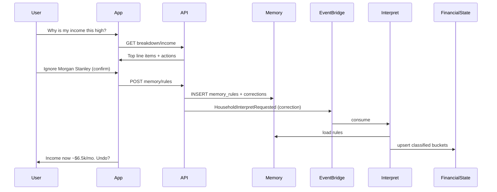

# Transaction Memory & Corrections

User-defined classification rules and line-item drill-down. The ledger stays immutable; classification
is an overlay in **Memory**, applied at Interpret time.

**Status:** Backend implemented. The correction *surface* is deferred to the desktop app — see
[v0-implementation-plan.md](../v0-implementation-plan.md) Stage 8.  
**Depends on:** Interpret v1 (`situations` table, `HouseholdInterpretRequested`)  
**Terminology:** [docs/terminology.md](../terminology.md) — Memory, Correction, Policy

> **Naming:** V0 Stage 0 renames `Situation` → `FinancialState` (table `situations` →
> `financial_states`, routes `/situation` → `/financial-state`). This doc still uses the old noun
> where it describes shipped code.

---

## Problem

Interpret classifies transactions with naive heuristics. Real households need:

1. **Ignore** one-off or non-economic flows (e.g. Morgan Stanley investment transfers).
2. **Reclassify** recurring merchants (e.g. Rocket Payment → payroll, not "loan credit").
3. **See line items** behind computed numbers.
4. **Manage rules** without re-explaining every month.

---

## Principles

| Principle | Implication |
|---|---|
| Ledger ≠ understanding | Never mutate `transactions`; store rules and per-txn overrides separately |
| Corrections → Interpret | Any Memory write triggers `HouseholdInterpretRequested` with `trigger: correction` |
| Confirm before retroactive | Default: apply new rules to the last 90 days; echo the exact pattern; confirm gate |
| Rules match patterns, not IDs | `raw_name` / merchant substring, optional account scope |
| Penny learns once | Don't re-ask about merchants the household already classified |

---

## Memory types (v1)

| Type | User intent | Effect on Interpret |
|---|---|---|
| **`ignore`** | "Don't count this at all" | Excluded from all buckets |
| **`payroll`** | "This is my paycheck" | Counts toward income / `income_shape` |
| **`transfer`** | "Moving my own money" | Excluded, like a built-in internal transfer |
| **`debt_service`** | "Paying down cards/loans" | Counts toward debt service; excluded from operating outflow |

V0 Stage 2 replaces these buckets with movement types (`INCOME`, `EXPENSE`, `TRANSFER`,
`DEBT_PAYMENT`, `INVESTMENT_CONTRIBUTION`, `REFUND`, `OTHER`). The Memory overlay and its precedence
carry over unchanged; only the target vocabulary changes.

### Precedence (highest wins)

1. **Per-transaction override** (`transaction_overrides`) — one transaction exception
2. **Household Memory rule** (`memory_rules`) — pattern match
3. **Built-in heuristics** (INTERNET TFR, MONEYLINE, etc.)
4. **Default** — depository positive = outflow, negative = inflow

---

## Data model

### `memory_rules`

Standing household rules.

```sql
CREATE TABLE memory_rules (
  id              UUID PRIMARY KEY DEFAULT gen_random_uuid(),
  household_id    UUID NOT NULL REFERENCES households(id) ON DELETE CASCADE,
  match_field     TEXT NOT NULL DEFAULT 'raw_name'
                  CHECK (match_field IN ('raw_name', 'merchant_name', 'either')),
  match_pattern   TEXT NOT NULL,          -- case-insensitive substring, stored uppercase
  account_id      UUID REFERENCES accounts(id) ON DELETE SET NULL,  -- NULL = all accounts
  action          TEXT NOT NULL
                  CHECK (action IN ('ignore', 'payroll', 'transfer', 'debt_service')),
  source          TEXT NOT NULL DEFAULT 'user'
                  CHECK (source IN ('user', 'penny_suggested', 'import')),
  source_channel  TEXT,
  created_by      UUID REFERENCES people(id),
  note            TEXT,
  active          BOOLEAN NOT NULL DEFAULT true,
  created_at      TIMESTAMPTZ NOT NULL DEFAULT now(),
  updated_at      TIMESTAMPTZ NOT NULL DEFAULT now()
);
```

**Example rows:**

| match_pattern | action | note |
|---|---|---|
| `ROCKET PAYMENT` | payroll | Works at Rocket Companies |
| `MORGAN STANLEY` | ignore | Investment transfers |

### `transaction_overrides`

Single-transaction exceptions. `action = 'default'` clears the override and falls back to rules.

```sql
CREATE TABLE transaction_overrides (
  id                    UUID PRIMARY KEY DEFAULT gen_random_uuid(),
  household_id          UUID NOT NULL REFERENCES households(id) ON DELETE CASCADE,
  plaid_transaction_id  TEXT NOT NULL,
  action                TEXT NOT NULL
                        CHECK (action IN ('ignore', 'payroll', 'transfer', 'debt_service', 'default')),
  reason                TEXT,
  created_at            TIMESTAMPTZ NOT NULL DEFAULT now(),
  UNIQUE (household_id, plaid_transaction_id)
);
```

> The table and the Interpret read path exist, but there is **no write path**. V0 Stage 8.2 adds one.

### `corrections`

Append-only log supporting undo and support debugging.

```sql
CREATE TABLE corrections (
  id            UUID PRIMARY KEY DEFAULT gen_random_uuid(),
  household_id  UUID NOT NULL REFERENCES households(id) ON DELETE CASCADE,
  person_id     UUID REFERENCES people(id),
  channel       TEXT NOT NULL,
  raw_input     TEXT,
  parsed_intent JSONB NOT NULL,
  rule_id       UUID REFERENCES memory_rules(id),
  override_id   UUID REFERENCES transaction_overrides(id),
  undone_at     TIMESTAMPTZ,
  created_at    TIMESTAMPTZ NOT NULL DEFAULT now()
);
```

---

## Interpret pipeline

```text
Ledger txns
  → load active memory_rules + transaction_overrides
  → classify each txn (precedence above)
  → bucket and aggregate to monthly estimates
  → persist financial state (+ line-item summaries in JSONB)
```

**Trigger:** `HouseholdInterpretRequested` with `trigger: correction | ledger_ingest | manual`.

**Module:** `src/core/src/interpret/classifyTransaction.ts` — pure function, unit tested.

---

## API

| Method | Path | Purpose |
|---|---|---|
| GET | `/api/household/:id/situation/breakdown?bucket=income&limit=5&offset=0` | Line items for drill-down |
| GET | `/api/household/:id/memory/rules` | List rules |
| POST | `/api/household/:id/memory/rules` | Create rule |
| PATCH | `/api/household/:id/memory/rules/:ruleId` | Deactivate (v1 supports deactivation only) |
| POST | `/api/household/:id/corrections/undo` | Undo last correction |
| POST | `/api/household/:id/interpret` | Trigger recompute |

Channels **present** corrections and **write** Memory. They do not compute financial state.

---

## Correction surface

The original plan delivered corrections over SMS. That surface has been removed; the desktop app is
the day-one surface instead.

The correction verbs the app needs, per
[penny-v1-implementation-context.md](../penny-v1-implementation-context.md) §13:

- transfer vs expense
- recurring vs one-time
- account ownership and purpose
- income source
- cash earmark
- ignore this transaction
- "that recurring $1,100 Venmo payment is rent"

Two mechanics carry over from the SMS design and are worth preserving:

1. **Confirm before applying.** Penny proposes rules and awaits confirmation rather than writing
   silently. This is implemented in `src/agent` as `requiresConfirmation` +
   `runAgentTurn({ interceptWrites: true })`, which returns a proposal instead of executing.
2. **Rule promotion.** When a one-off correction generalizes, offer to make it a durable rule so the
   household is not asked again.

---

## Acceptance scenario

**Starting state:** income ~$58k/mo, outflow ~$11.5k/mo, runway ~3.4 months — inflated because
investment transfers were counted as income.

**Corrections:** `MORGAN STANLEY` → ignore; `ROCKET PAYMENT` → payroll.

**Expected end state:**

| Bucket | ~Monthly |
|---|---:|
| Payroll (RHP + Rocket) | ~$6–7k |
| Ignored (Morgan Stanley) | $0 in income |
| Operating outflow | ~$4.3k |
| Operating runway | ~9 months on $39k liquid |

---

## Open decisions

| # | Question | Status |
|---|---|---|
| 1 | Retroactive default? | Yes, 90 days; show before/after in the confirm step |
| 2 | Rule scope | Household-wide default; optional `account_id` |
| 3 | Pattern syntax | Substring match; regex deferred |
| 4 | Credit-card transactions | **Resolved** — V0 Stage 2.2 counts card purchases as spending |
| 5 | Transaction override write path | Open — V0 Stage 8.2 |

---

## Sequence


